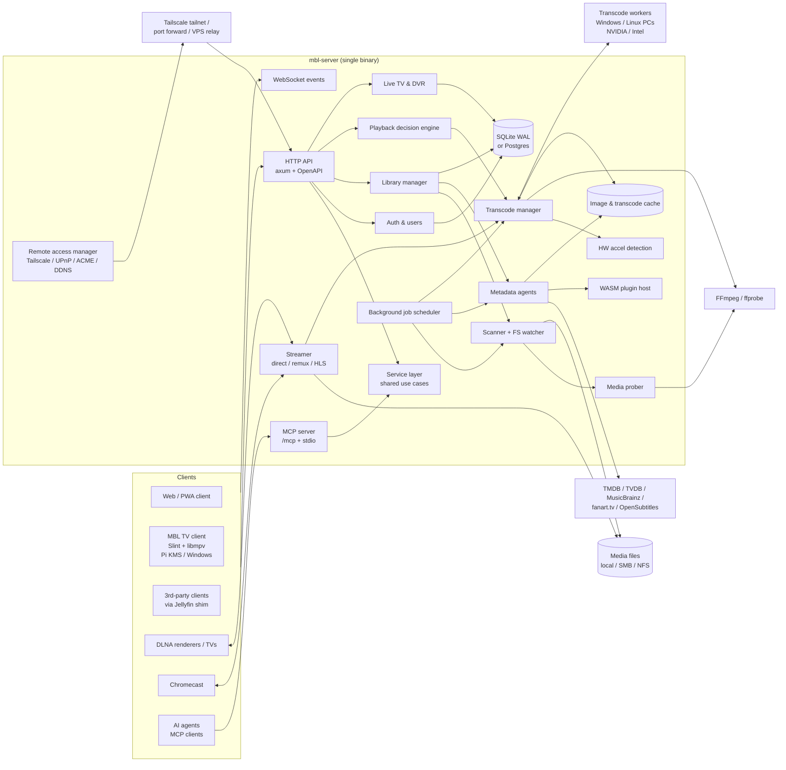
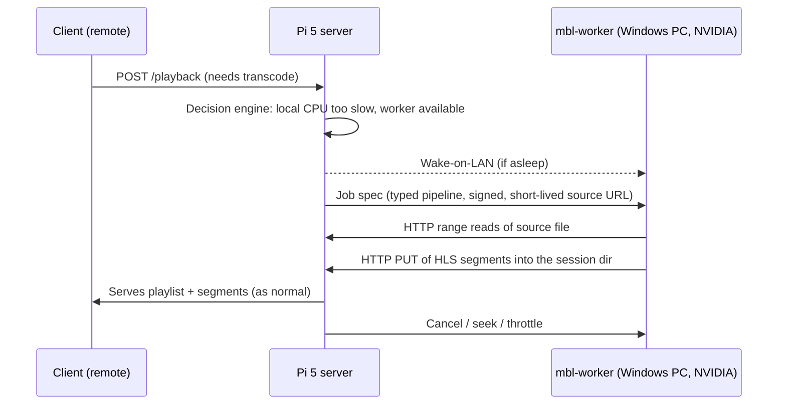
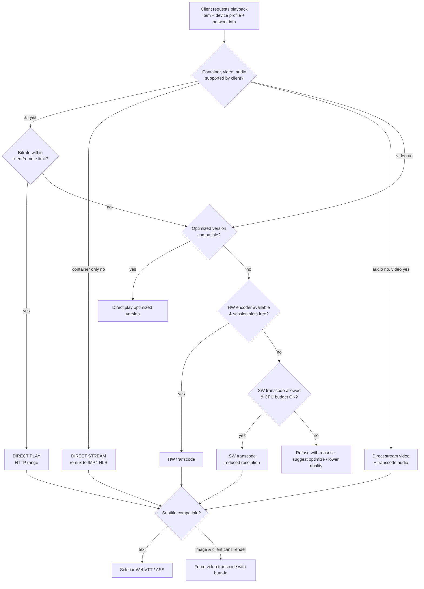
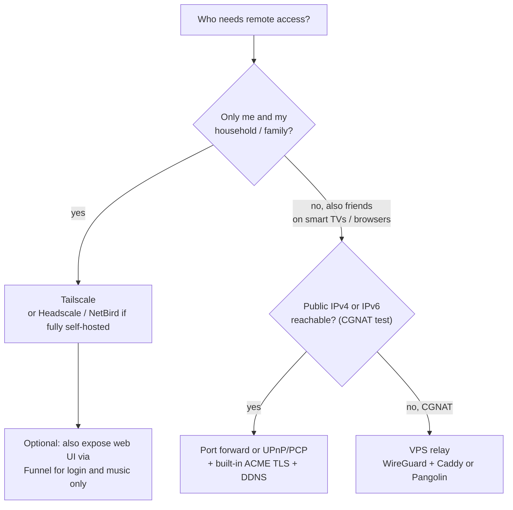

# MBL Media Center — Project Plan

> Working name: **MBL**. An open source, Plex-inspired media server and client ecosystem written in Rust. The primary target is the **Raspberry Pi 5**. It also runs well on Windows and Linux PCs and makes full use of **NVIDIA and Intel GPU transcoding** when available.
>
> Step-by-step implementation tasks: [IMPLEMENTATION.md](IMPLEMENTATION.md).

---

## 1. Vision and Goals

### 1.1 Vision
A self-hosted media center that organizes movies, TV, music, photos and live TV, and streams them to any device, at home or remotely. It should look and feel as modern and polished as Plex, but be fully open source and use far fewer resources.

- **The Raspberry Pi 5 is the reference platform.** Every feature is designed, tuned and tested on it first. The Pi 4 is fully supported.
- **PC-class hardware is a first-class "power-up".** A Windows or Linux machine with an NVIDIA or Intel GPU unlocks Plex-level transcoding. That machine can be the server itself, or a **transcode worker** that a Pi 5 server offloads work to (§6.8).

### 1.2 Primary goals
| # | Goal | Measurable target |
|---|------|-------------------|
| G1 | Feature parity with core Plex functions (see §3) | All P0/P1 features in §3 shipped by v1.0 |
| G2 | Rust implementation | 100% Rust server; FFmpeg is the only large native dependency |
| G3 | Hardware acceleration | VAAPI, QSV, NVENC/NVDEC, AMF, D3D11VA, V4L2 M2M (Pi), RKMPP (Rockchip) |
| G4 | Best-in-class on Raspberry Pi 5 (Pi 4 supported) | Idle RAM < 80 MB, idle CPU < 1%, 10k-item library scan < 3 min on a Pi 5 with NVMe (< 5 min on a Pi 4 with USB SSD) |
| G5 | Strong Windows support | Native service, installer, tray app, D3D11/QSV/NVENC/AMF, UNC paths |
| G6 | Open and extensible | Documented OpenAPI REST API, WASM plugin system, no mandatory cloud account |
| G7 | Modern interface | Shared design system across web, TV and desktop; 60 fps UI on a Pi 5; WCAG 2.2 AA (§10) |
| G8 | Excellent transcoding on PC hardware | Full GPU pipelines on NVIDIA/Intel, an adaptive multi-bitrate ladder, and offloading from a Pi to GPU workers (§6.7, §6.8) |
| G9 | Easy, secure remote streaming | Guided setup for Tailscale, direct access or a VPS relay, plus bandwidth-aware quality selection (§13) |
| G10 | AI-native | Built-in MCP server; ≥ 95% of admin and user capabilities available as MCP tools, with scoped permissions, confirmations and an audit log (§9.5) |

### 1.3 Non-goals (for v1.0)
- No proprietary cloud relay run by the project and no mandatory online accounts. Remote access is self-managed, with first-class *optional* integrations (Tailscale/Headscale, ACME, UPnP) described in §13.
- No reimplementation of the Plex wire protocol. Official Plex clients are proprietary and depend on plex.tv.
- No native iOS or Android apps in v1.0. Use the PWA plus a Jellyfin-compatible API shim (§9.4) to support existing third-party clients.
- No DRM-protected content.

### 1.4 Why build this instead of using Jellyfin?
- **Resource footprint:** a Rust/Tokio server with no .NET runtime is a better fit for 1–8 GB ARM boards.
- **Pi-first transcoding strategy:** Pi 5 has *no hardware video encoder*, so the server must avoid transcoding where possible instead of assuming a GPU (§6.4).
- **Integrated 10-foot client** that renders directly to KMS/DRM on the Pi, with no desktop environment and no browser.
- **Modern architecture:** a single static binary, a typed API, and WASM plugins.
- **AI-native:** a built-in Model Context Protocol (MCP) server lets any AI agent (Claude, Copilot, Cursor, local LLMs) manage, diagnose and control the whole media center safely (§9.5).

---

## 2. High-Level Architecture



### 2.1 Architectural principles
1. **Single binary, modular crates.** One `mbl-server` executable, built from a Cargo workspace of focused crates.
2. **Async everywhere.** Use Tokio. Run blocking work (hashing, image decoding, SQLite) on `spawn_blocking` or dedicated pools with bounded concurrency.
3. **FFmpeg as an out-of-process worker.** Transcodes run as supervised `ffmpeg` child processes. This isolates crashes, makes them easy to kill and throttle, and avoids FFmpeg license contamination (§16). `ffprobe` JSON output is used for probing. In-process `ffmpeg-next` bindings are an optional later optimization for thumbnails only.
4. **Resource-aware by design.** Every subsystem has configurable concurrency limits. Default limits are chosen from the detected platform profile (Pi 4, Pi 5, x86 desktop, and so on).
5. **Direct play first.** Transcoding is the last resort. This matters most on the Pi.
6. **Storage-friendly.** Minimize random writes to protect SD cards. Batch database writes, use WAL, and put temp transcode output on tmpfs when RAM allows.
7. **One service layer, many front doors.** All business logic lives in `mbl-service`. The REST API (`mbl-api`) and the MCP server (`mbl-mcp`) are thin adapters over it, so they share permission checks and behavior and cannot drift apart.

---

## 3. Feature Scope (Plex parity map)

Priority: **P0** = MVP, **P1** = v1.0, **P2** = post-1.0.

### 3.1 Server and library
| Feature | Plex equivalent | Priority |
|---|---|---|
| Libraries: Movies, TV Shows, Music, Photos, Home Videos | Library types | P0 |
| Multiple folders per library, mixed local/network paths | Same | P0 |
| Initial scan + incremental rescan + real-time FS watching | "Scan automatically" | P0 |
| Filename parsing (Plex/Kodi naming conventions) | Plex naming guide | P0 |
| Local metadata: NFO, local posters/fanart, embedded tags | Local Media Assets | P0 |
| Online metadata agents: TMDB, TVDB, MusicBrainz, fanart.tv | Plex agents | P0 (TMDB), P1 (others) |
| Manual match / fix match / unmatch, edit metadata, lock fields | Same | P1 |
| Collections (manual + auto from TMDB collections) | Collections | P1 |
| Smart collections / smart playlists (rule-based filters) | Smart collections | P2 |
| Multiple editions / versions of a movie (4K + 1080p, Director's Cut) | Editions / versions | P1 |
| Extras (trailers, featurettes, behind the scenes) | Extras | P1 |
| Intro detection & skip (audio fingerprinting) | Skip Intro | P1 |
| Credits detection & skip | Skip Credits | P2 |
| Chapter thumbnails & trickplay/seek previews (BIF-like sprites) | Video preview thumbnails | P1 |
| Optimized versions (pre-transcode for devices/remote) | Optimize | P1 (key for Pi) |
| Subtitles: embedded, external (SRT/ASS/VTT/PGS), OpenSubtitles search | Same | P0 (local), P1 (search) |
| Audio track & subtitle default preferences per user | Same | P1 |
| Trash / missing file handling, empty trash | Same | P1 |
| Scheduled tasks: backup DB, optimize DB, refresh metadata, cleanup | Scheduled Tasks | P1 |
| Server dashboard: now playing, bandwidth, transcode reasons | Dashboard | P1 |
| Server-side activity log and statistics (watch history) | Dashboard/History | P1 |

### 3.2 Users and sharing
| Feature | Priority |
|---|---|
| Admin + local user accounts, password (Argon2id) | P0 |
| Managed/child profiles with PIN, parental ratings limits | P1 |
| Per-user library access, per-user watch state | P0 |
| Quick user switching (Plex Home equivalent) | P1 |
| Sharing with remote users (invite links, per-library restrictions, bandwidth limits) | P1 |
| OIDC / SSO login (Authentik, Keycloak, Authelia) | P2 |
| API tokens for automation (Sonarr/Radarr/Tautulli-style tools) | P1 |

### 3.3 Playback and streaming
| Feature | Priority |
|---|---|
| Direct play (HTTP range requests) | P0 |
| Direct stream (remux container only, e.g. MKV→fMP4) | P0 |
| Full transcode to HLS (fMP4/CMAF segments; TS fallback) | P0 |
| Hardware-accelerated transcode (§6) | P0 (VAAPI/QSV/NVENC/V4L2), P1 (rest) |
| HDR → SDR tone mapping (HW where possible) | P1 |
| Audio transcode only (e.g. TrueHD/DTS → AAC/AC3/Opus) | P0 |
| Subtitle burn-in for image subtitles (PGS/VobSub) when client can't render | P1 |
| Bandwidth-adaptive quality, remote quality limits | P1 |
| Resume, watched status, "Continue Watching", "On Deck"/"Up Next" | P0 |
| Watch Together (synchronized group playback) | P2 |
| Playback history and scrobbling (Trakt, ListenBrainz, Last.fm via plugins) | P2 |

### 3.4 Music
| Feature | Priority |
|---|---|
| Artist/album/track browsing, tag-based (ID3, Vorbis, FLAC, MP4) | P0 |
| MusicBrainz matching, album art, artist images | P1 |
| Gapless playback, ReplayGain/loudness normalization (EBU R128 analysis) | P1 |
| Lossless direct play, on-the-fly transcode to Opus/AAC/MP3 | P0 |
| Playlists (manual/smart), radio/mix from artist (tag+similarity) | P1/P2 |
| Lyrics (embedded, LRC sidecar, synced) | P2 |
| Subsonic/OpenSubsonic API compatibility (huge client ecosystem) | P1 |

### 3.5 Photos
| Feature | Priority |
|---|---|
| Folder & date-based browsing, EXIF parsing, thumbnails | P1 |
| HEIC/AVIF/RAW preview support (via libvips/libheif optional feature) | P2 |
| Slideshows, timeline view | P2 |

### 3.6 Live TV and DVR
| Feature | Priority |
|---|---|
| HDHomeRun tuner discovery and streaming | P1 |
| M3U/IPTV sources + XMLTV EPG | P1 |
| EPG guide UI, channel mapping | P1 |
| Scheduled recordings, series recordings, padding, conflict resolution | P1 |
| Commercial detection (comskip integration as optional external tool) | P2 |
| Live TV time-shift (pause/rewind via ring buffer) | P2 |

### 3.7 Discovery and integration
| Feature | Priority |
|---|---|
| DLNA/UPnP Media Server (ContentDirectory) | P1 |
| Chromecast casting (from web client, custom receiver app) | P1 |
| Remote control: control a TV client from a phone/web (companion protocol over WebSocket) | P1 |
| mDNS/SSDP server discovery on LAN | P0 |
| Webhooks (play/pause/stop/library.new) | P1 |
| Offline downloads / sync to client device | P2 |
| Jellyfin-compatible API shim for third-party clients | P2 |

### 3.8 AI-native control (MCP)
| Feature | Priority |
|---|---|
| MCP server (Streamable HTTP at `/mcp` + stdio via `mbl-cli mcp`) with read-only tools: search, browse, item details, sessions, playback explanation, logs, HW report | P0 |
| Scoped API tokens for MCP, audit log, MCP admin page (tokens, activity, kill switch) | P0 |
| Mutating tools: scans, metadata fix-match/edit, watched state, collections/playlists, optimized versions, jobs, users, settings | P1 |
| Player control tools ("play X on the living-room TV") via the companion protocol | P1 |
| MCP resources with subscriptions (active sessions, scan progress, logs) and prompts (diagnose playback, library health check, …) | P1 |
| OAuth 2.1 authorization for MCP (per the MCP spec) with a consent screen and per-client scopes | P1 |
| Confirmations via MCP elicitation, plus `dry_run` on every mutating tool | P1 |
| Optional in-app assistant (user-configured LLM, e.g. Ollama or any OpenAI-compatible endpoint) and natural-language search | P2 |

---

## 4. Technology Stack

### 4.1 Server
| Concern | Choice | Rationale |
|---|---|---|
| Async runtime | `tokio` | De facto standard; good aarch64 support |
| HTTP | `axum` + `tower` + `tower-http` (compression, CORS, tracing, limits) | Ergonomic, fast, middleware ecosystem |
| TLS | `rustls` + `instant-acme` (Let's Encrypt) | No OpenSSL dependency, which makes cross-compiling easier |
| OpenAPI | `utoipa` + `utoipa-swagger-ui` / Scalar | Generates the typed API and client SDKs |
| Database | `sqlx` with SQLite (default) and Postgres (optional feature) | Compile-time checked queries, migrations |
| Search | SQLite FTS5 (default); `tantivy` optional for large libraries | Zero-config; scalable option |
| Serialization | `serde`, `serde_json`, `quick-xml` (NFO, DLNA, XMLTV) | |
| FS watching | `notify` (inotify / ReadDirectoryChangesW / FSEvents) + polling fallback | Network shares often don't emit events |
| Process mgmt | `tokio::process` + custom supervisor | FFmpeg workers |
| Images | `image` + `fast_image_resize`; optional `libvips` feature | Fast thumbnails; NEON/SSE/AVX SIMD |
| Audio analysis | `symphonia` (decode), `ebur128` (loudness), `rusty-chromaprint` (intro detection) | Pure Rust |
| Tags | `lofty` | Pure-Rust audio tag reading |
| EXIF | `kamadak-exif` | |
| HTTP client | `reqwest` (rustls) with per-host rate limiting (`governor`) | Metadata API politeness |
| Auth | `argon2`, opaque session tokens (DB-backed), optional JWT for stateless API tokens; `openidconnect` for SSO | |
| Config | `figment` (TOML file + env vars + CLI) | |
| Logging/metrics | `tracing`, `tracing-subscriber`, `tracing-appender`; `metrics` + Prometheus exporter | |
| Discovery | `mdns-sd`, custom SSDP (UDP multicast) | |
| Plugins | `wasmtime` + WIT component model | Sandboxed and language-agnostic |
| MCP | `rmcp` (official Rust MCP SDK) + `schemars` for tool input/output schemas | Streamable HTTP (mounted in axum) and stdio transports |
| Scheduling | `tokio-cron-scheduler` or in-house job queue persisted in DB | Resumable jobs |
| CLI | `clap` | `mbl-server`, `mbl-cli` admin tool |
| Windows service | `windows-service` | Native SCM integration |
| Linux service | systemd unit + `sd-notify` | Watchdog, readiness |
| Remote access | `igd-next` (UPnP-IGD), NAT-PMP/PCP client, Tailscale LocalAPI client (HTTP over Unix socket / named pipe), optional `libtailscale` FFI | §13 |
| Worker RPC | HTTP/2 + JSON over mTLS (`rustls`), or `tonic` gRPC | Server ↔ transcode worker protocol (§6.8) |

### 4.2 Clients
| Client | Stack | Notes |
|---|---|---|
| **Web / PWA** | TypeScript + SolidJS (or Svelte), Vite, TanStack Router/Query/Virtual, Kobalte (accessible headless components), vanilla-extract + design tokens, Motion, `hls.js`, generated API SDK from OpenAPI | Primary UI for desktop browsers, phones and admin. Served by the server. See §10. |
| **MBL TV (10-foot client)** | Rust + **Slint** UI (has a `linuxkms` backend with no X11/Wayland) + **libmpv** (via `libmpv2` crate) for playback | Runs on Pi 4/5 directly on KMS/DRM with HW decode. The same codebase runs on Windows (D3D11) and Linux desktops. Supports CEC remote control via `libcec`. |
| **Chromecast receiver** | Custom Web Receiver (TS) | Optional; default media receiver works for direct play |
| **Admin CLI** | Rust (`clap`, shares the `mbl-api-client` crate) | Scripting, headless setup on Pi |

> Alternative considered for the web client: Leptos/Dioxus (Rust→WASM). Rejected for v1 because the hls.js/MSE ecosystem and contributor pool are much larger in TS. It can be revisited later.

### 4.3 Native dependencies
- **FFmpeg ≥ 6.1** (7.x preferred). The server never links against it. It is detected or bundled per platform:
  - Raspberry Pi OS: the distro `ffmpeg` package, which includes Raspberry Pi's patches for `v4l2m2m` and `v4l2-request`/DRM hwaccel for HEVC.
  - Windows: bundled GPL or LGPL build (for example BtbN or gyan.dev-style builds) with QSV/NVENC/AMF/D3D11 enabled.
  - Docker: custom multi-arch FFmpeg build layer.
- **libmpv** (TV client only).
- Optional: `libvips`, `libheif`, `libcec`, `comskip`.

---

## 5. Repository and Crate Layout

```
mbl/
├── Cargo.toml                    # workspace
├── crates/
│   ├── mbl-server/               # binary: wiring, config, startup, service integration
│   ├── mbl-core/                 # domain types: MediaItem, Library, User, IDs, errors
│   ├── mbl-db/                   # sqlx repositories, migrations (sqlite + postgres)
│   ├── mbl-api/                  # axum routers, DTOs, OpenAPI, auth middleware
│   ├── mbl-service/              # application use cases + permission checks (shared by REST and MCP)
│   ├── mbl-mcp/                  # MCP server: tools, resources, prompts (rmcp)
│   ├── mbl-auth/                 # users, sessions, tokens, Argon2, OIDC, permissions
│   ├── mbl-scanner/              # filesystem walker, watcher, change detection
│   ├── mbl-parser/               # filename/path parsing (movies, episodes, music)
│   ├── mbl-probe/                # ffprobe wrapper, media stream model
│   ├── mbl-metadata/             # agent trait + TMDB/TVDB/MusicBrainz/fanart/NFO agents
│   ├── mbl-images/               # artwork download, resize, blurhash, cache
│   ├── mbl-hwaccel/              # platform & GPU detection, capability matrix, self-test
│   ├── mbl-transcode/            # FFmpeg command builder, session mgr, throttling
│   ├── mbl-playback/             # decision engine, client profiles, stream negotiation
│   ├── mbl-stream/               # direct play, remux, HLS playlist/segment serving
│   ├── mbl-analysis/             # intro/credits detection, loudness, trickplay
│   ├── mbl-livetv/               # tuners, M3U, XMLTV, DVR scheduler, recorder
│   ├── mbl-dlna/                 # SSDP + UPnP ContentDirectory/ConnectionManager
│   ├── mbl-discovery/            # mDNS, LAN discovery
│   ├── mbl-jobs/                 # persistent job queue, scheduler, resource limiter
│   ├── mbl-plugins/              # wasmtime host, WIT interfaces
│   ├── mbl-compat-subsonic/      # OpenSubsonic API layer
│   ├── mbl-compat-jellyfin/      # Jellyfin API shim (P2)
│   ├── mbl-platform/             # OS abstractions: paths, service, thermal, power, tray
│   ├── mbl-remote/               # remote access: Tailscale LocalAPI, UPnP/PCP, ACME, DDNS, reachability
│   ├── mbl-worker/               # transcode worker binary (Windows/Linux GPU machines)
│   ├── mbl-api-client/           # generated/handwritten Rust API client
│   ├── mbl-cli/                  # admin CLI binary
│   ├── mbl-ui-kit/               # Slint component library generated from design tokens
│   └── mbl-tv/                   # 10-foot client binary (Slint + libmpv)
├── design/                       # design tokens (W3C format), icons, Penpot source files
├── web/                          # SolidJS web client
├── plugins/                      # WIT definitions + example plugins
├── packaging/
│   ├── debian/                   # .deb (arm64, armhf?, amd64)
│   ├── pi-image/                 # pi-gen stage for "MBL OS" image
│   ├── docker/                   # multi-arch Dockerfiles
│   ├── windows/                  # WiX installer, tray app assets
│   └── systemd/
├── test-media/                   # scripts to generate synthetic test corpus
├── docs/                         # mdBook: user guide, admin guide, API, dev guide
└── .github/workflows/
```

---

## 6. Hardware Acceleration Strategy (core differentiator)

### 6.1 Platform capability matrix (target support)

| Platform | Decode | Encode | FFmpeg path | Tier |
|---|---|---|---|---|
| **Raspberry Pi 5** (BCM2712) | **HEVC only** (HW, via V4L2 stateless/`v4l2-request` + DRM PRIME) | **None**: software only (libx264 on 4× A76) | `-hwaccel drm` (Pi-patched FFmpeg) | 1 |
| **Raspberry Pi 4 / CM4 / Pi 400** | H.264 (`h264_v4l2m2m`), HEVC (V4L2 stateless) | H.264 up to 1080p30-ish (`h264_v4l2m2m`) | `v4l2m2m`, `-hwaccel drm` | 1 |
| Raspberry Pi 3 / Zero 2 W | H.264 (legacy, limited) | H.264 (limited) | `v4l2m2m` | 3 (client only) |
| **Intel iGPU** (Gen9+ / N100 / Arc) | H.264, HEVC, VP9, AV1 (Gen12+) | H.264, HEVC, AV1 (Arc / Gen12.5+) | Linux: VAAPI or QSV (oneVPL); Windows: QSV / D3D11VA | 1 |
| **NVIDIA** (Maxwell+) | NVDEC | NVENC (H.264/HEVC/AV1 on Ada+) | CUDA / `*_nvenc`, `scale_cuda`, `tonemap_cuda` | 1 |
| **AMD** | Linux: VAAPI; Windows: D3D11VA | Linux: VAAPI; Windows: AMF | `vaapi`, `*_amf` | 1 (Win AMF), 2 (Linux) |
| **Rockchip RK3588** (Orange Pi 5, Rock 5) | H.264/HEVC/VP9/AV1 | H.264/HEVC | `rkmpp` (Rockchip FFmpeg fork / upstream progress) | 2 |
| **NVIDIA Jetson** | NVDEC | NVENC (not Orin Nano) | `nvv4l2` / l4t FFmpeg | 3 |
| **Apple Silicon (macOS)** | VideoToolbox | VideoToolbox | `videotoolbox` | 3 (best effort) |
| **Generic CPU** | Software | libx264 / libx265 / libsvtav1 | — | Always available |

> **Critical insight for the Pi:** The Pi 5 dropped the hardware H.264 encoder and H.264 decoder. On a Pi 5, a full video transcode is always a CPU transcode. Libx264 `veryfast` at 1080p is borderline real-time for a single stream on a Pi 5 and is not feasible on a Pi 4. The Pi strategy (§6.4) is therefore built around *avoiding* video transcodes.

### 6.2 Hardware detection (`mbl-hwaccel`)
1. **Platform fingerprint:**
   - Linux: read `/proc/device-tree/model`, `/proc/cpuinfo`, `/sys/class/drm/*`, `/dev/dri/renderD*`, `/dev/video*` (query V4L2 caps via `VIDIOC_QUERYCAP` / `ENUM_FMT`), `/dev/nvidia*`.
   - Windows: DXGI adapter enumeration (`windows` crate) for vendor ID 0x8086/0x10DE/0x1002, driver version, and dedicated memory.
2. **FFmpeg capability probe:** `ffmpeg -hide_banner -hwaccels`, `-encoders`, `-decoders`, `-filters`. Parse which `*_vaapi`, `*_qsv`, `*_nvenc`, `*_amf`, `*_v4l2m2m`, `*_rkmpp`, `tonemap_*`, `scale_*`, and `overlay_*` entries exist.
3. **Functional self-test** (most important step): for each candidate pipeline, run a 2-second encode of a generated test pattern (`-f lavfi -i testsrc2`) at 1080p, plus a decode of bundled tiny H.264/HEVC/10-bit HEVC/AV1 samples. Record success, fps, and any errors. Drivers often *claim* support they don't deliver, which is why the test is needed.
4. **Persist results** in a `hw_capabilities` table. Re-run on FFmpeg version change, driver change, or manual request from the dashboard.
5. **Expose results** in the admin UI as a readable report, e.g. "Intel UHD 770 via QSV: decode H.264/HEVC/AV1, encode H.264/HEVC, HDR tone mapping available, max ~8 concurrent 1080p transcodes."

### 6.3 Transcode pipeline builder (`mbl-transcode`)
- A typed `Pipeline` model with input, decoder (hw/sw), filter graph (scale, deinterlace, tonemap, subtitle overlay, format conversion, hwupload/hwdownload), encoder, muxer, and segmenter. It compiles to FFmpeg CLI args.
- **Keep frames on the GPU:** full-hardware paths (e.g. `-hwaccel qsv -hwaccel_output_format qsv … scale_qsv … h264_qsv`). Fall back gracefully to hybrid (HW decode → SW filter → HW encode) and then to full software.
- **Fallback chain per session:** if FFmpeg exits with an error within the first N seconds, retry with the next pipeline in the chain and flag the failing combination in the capability cache.
- **Argument safety:** never interpolate user strings into args. File paths are passed as discrete `Command::arg`s. Filter strings that need paths (subtitles) are escaped through a dedicated escaper with unit and fuzz tests.
- **Per-platform presets:**
  - x86 QSV: `-preset veryfast`, `look_ahead 0`, low-power (VDEnc) mode when supported.
  - NVENC: `-preset p4 -tune ll`, respecting the session limit on consumer cards (detect and expose it).
  - V4L2M2M (Pi 4): `h264_v4l2m2m` with `-b:v` (CBR-ish). It must use `nv12/yuv420p` input and cap at 1080p. A single concurrent HW encode by default.
  - Software: `libx264 -preset veryfast/superfast -tune zerolatency` (adaptive). Pi 5 uses `ultrafast` at 720p for remote streams.

### 6.4 Raspberry Pi playback strategy ("avoid transcoding")
1. **Direct play everything possible.** The decision engine uses detailed client capability profiles (codec, profile, level, bit depth, HDR, container, audio codecs, channel count, subtitle formats).
2. **Direct stream (remux)** when only the container is incompatible (MKV→fMP4 HLS). It costs nearly zero CPU.
3. **Audio-only transcode** when only the audio is incompatible (DTS/TrueHD→AAC/AC3/Opus). It is cheap on any Pi.
4. **Subtitles without burn-in:** convert text subtitles (SRT/ASS) to WebVTT, or serve ASS to clients that support it (the web client uses `JASSUB`/libass-wasm). Image subtitles (PGS) are rendered client-side in the web client (PGS renderer in JS) to avoid burn-in transcodes.
5. **Optimized versions:** a background job converts selected titles (or "everything added to library X") into a universal profile (H.264 High@4.1 1080p/720p + AAC stereo in MP4). It runs at low priority (`nice 19`, `ionice idle`) and only during a configurable night window. Thermal throttling pauses it. This is the Pi's answer to remote streaming.
6. **Remote streaming without optimized versions:** Pi 4 uses `h264_v4l2m2m` (1 stream). Pi 5 uses software 720p with an admin-configurable concurrent transcode limit (default 1). Clients get a clear "Server can't transcode this right now" message with options instead of stuttering.
7. **Thermal and power awareness:** read `/sys/class/thermal/thermal_zone0/temp`, and use `vcgencmd get_throttled` or the equivalent sysfs/mailbox interface to detect under-voltage and throttling. Surface warnings in the dashboard ("Under-voltage detected: use the official 27 W PSU").
8. **Platform profile defaults (Pi):** scanner concurrency 2, image resize threads 2, analysis jobs 1 (only when idle), FS watcher plus a lower-frequency poll for network mounts, SQLite cache sized from available RAM.

### 6.5 HDR handling
- Detect HDR10/HDR10+/HLG/Dolby Vision (profiles 5/7/8) via ffprobe side data.
- Prefer passthrough to HDR-capable clients. DV Profile 8 falls back to its HDR10 base layer when a client lacks DV. DV Profile 5 requires tone mapping (it has no compatible base layer).
- Tone mapping: `tonemap_opencl`, `tonemap_cuda`, `vpp_qsv` (tone mapping), `tonemap_vaapi`, or `libplacebo` (Vulkan) when available. Software `zscale+tonemap` is a last resort and is **disabled by default on Pi** (too slow). The UI states the reason.

### 6.6 Hardware acceleration in the TV client (`mbl-tv`)
- libmpv with `hwdec=auto-safe`, `vo=gpu-next` (or `vo=drm`/`dmabuf-wayland` on Pi).
  - Pi 4/5: `hwdec=drm`/`v4l2request` for HEVC, `v4l2m2m-copy` for H.264 on Pi 4. Pi 5 decodes H.264 in software, which works well at 1080p on A76 cores.
  - Windows: `hwdec=d3d11va`, `vo=gpu-next`, `gpu-api=d3d11`.
- KMS mode setting: output 4K60 HDR on Pi 5 via the HDMI HDR metadata path (libmpv + DRM properties). Use auto refresh-rate switching (match 23.976/24/25/50/59.94).
- The Slint UI is rendered via its `linuxkms` backend with GLES/femtovg or the Skia renderer. Video and UI are composited using DRM planes (video on the primary/overlay plane, UI on top) to keep GPU load low.

### 6.7 PC-class transcoding: Windows, NVIDIA and Intel
When the server, or a worker (§6.8), runs on a PC with a capable GPU, MBL switches from "avoid transcoding" to "transcode freely and well".

**NVIDIA (Windows and Linux)**
- Full-GPU pipeline: `-hwaccel cuda -hwaccel_output_format cuda` → `scale_cuda` / `yadif_cuda` / tone mapping → `h264_nvenc` / `hevc_nvenc` / `av1_nvenc` (Ada and newer). Frames never leave VRAM.
- Tone mapping uses `tonemap_cuda` where the curated FFmpeg build provides it (see below), otherwise `libplacebo` on Vulkan, or `tonemap_opencl`.
- Detect the driver's concurrent NVENC session limit on GeForce cards and show it in the dashboard. Never silently exceed it; queue or fall back instead.
- Windows: prefer CUDA/NVDEC over D3D11VA for full-GPU paths, and use D3D11VA for mixed paths. Linux: needs the proprietary driver plus `nvidia-container-toolkit` for Docker.

**Intel (iGPU UHD/Iris Xe, N100/N150 mini-PCs, Arc A/B-series dGPUs)**
- Linux: QSV through oneVPL (`-hwaccel qsv`) or VAAPI. Low-power (VDEnc) encoding needs GuC/HuC firmware on some generations; detect this and explain it in the HW report.
- Windows: QSV through D3D11 (`-init_hw_device d3d11va` + `qsv` derived device).
- Filters: `vpp_qsv` (scale, deinterlace, tone mapping) or `scale_vaapi` / `tonemap_vaapi`.
- **Arc and Gen12.5+:** hardware AV1 encode. A low-cost Arc card makes an excellent transcode worker for remote streaming because AV1 roughly halves bitrate compared with H.264.

**Curated FFmpeg builds**
- Ship `mbl-ffmpeg` builds based on the proven jellyfin-ffmpeg build scripts (GPL), with up-to-date oneVPL, NVENC headers, libplacebo, OpenCL and CUDA tone mapping, and fixed versions so the self-test results stay valid.
- Users can still point MBL at their own FFmpeg.

**Capabilities only unlocked on GPU machines**
| Capability | Description |
|---|---|
| **Adaptive bitrate (ABR) ladder** | One decode, split into 2–3 renditions (for example 1080p 8 Mbps, 720p 4 Mbps, 480p 1.5 Mbps) in a single FFmpeg process. The client switches quality automatically without restarting the session. Disabled on Pi (single rendition). |
| **HEVC/AV1 output for remote** | When the client supports it, encode in HEVC or AV1 instead of H.264 to fit more quality into a limited home upload. |
| **HDR → SDR tone mapping at 4K** | Real-time, several streams at once. |
| **Burn-in subtitles at no cost** | `overlay_cuda` / `overlay_qsv`. |
| **Fast optimized versions** | Bulk pre-transcoding at many times real-time speed. |
| **Higher concurrency defaults** | Sized from the self-test fps (for example `max_sessions = floor(measured_fps / 30 × 0.8)`). |

### 6.8 Distributed transcode workers (Pi 5 server + GPU PC)
A common household setup is a quiet, always-on Pi 5 holding the library, plus a gaming PC or mini-PC with an NVIDIA or Intel GPU that is often idle or asleep. MBL lets the Pi borrow that GPU.



- **`mbl-worker`** is a small Rust binary with a Windows service and a Linux systemd unit. It runs the same `mbl-hwaccel` self-test and reports its capabilities and current load to the server.
- **Pairing:** a one-time code shown in the admin UI. After pairing, server and worker talk over mutual TLS with pinned certificates. Workers can sit on the LAN or on the tailnet (§13).
- **No remote command execution:** the server sends a *typed* `Pipeline` spec, not FFmpeg arguments. The worker builds the arguments itself with the same builder and escaper as the server.
- **Media access:** the worker reads source files via authenticated HTTP range requests from the server, so it needs no SMB shares or path mapping. Optional path mapping lets it read directly from a NAS share for higher throughput.
- **Scheduling:**
  1. Local hardware that can do the job in real time.
  2. An awake worker with free capacity.
  3. Waking a sleeping worker with Wake-on-LAN. The client sees a "Starting transcoder…" state for a few seconds.
  4. Local software transcode, if allowed.
  5. Refuse, with the reason shown.
- **Batch jobs:** optimized versions, trickplay and intro analysis can be sent to workers only (for example "only when the PC is idle and between 01:00 and 07:00").
- **Failure handling:** heartbeats every 5 s. If a worker vanishes, the session migrates back to the local fallback at the current segment boundary.
- **Gaming-friendly (Windows):** "pause when a fullscreen app or game is running" (GPU usage threshold) and a tray icon showing current jobs.

---

## 7. Data Model (initial schema outline)

```text
libraries(id, name, kind[movie|show|music|photo|homevideo], settings_json, created_at)
library_paths(id, library_id, path, is_network, last_scan_at)

media_items(id, library_id, kind[movie|show|season|episode|artist|album|track|photo|collection|extra],
            parent_id, grandparent_id, title, sort_title, original_title, year,
            index, parent_index, originally_available_at, summary, tagline,
            content_rating, studio, rating, audience_rating, duration_ms,
            guid_tmdb, guid_tvdb, guid_imdb, guid_musicbrainz,
            locked_fields_json, added_at, updated_at, metadata_refreshed_at)

media_versions(id, item_id, edition_name, container, bitrate, width, height,
               video_codec, video_profile, bit_depth, hdr_type, audio_codec, audio_channels,
               is_optimized, optimized_profile)
media_parts(id, version_id, file_path, file_size, mtime, inode_or_fileid, quick_hash,
            duration_ms, probe_json, chapters_json, missing_since)
streams(id, part_id, index, kind[video|audio|subtitle|attachment], codec, language, title,
        is_default, is_forced, is_external, external_path, channels, profile, ...)

people(id, name, tmdb_id, thumb), item_people(item_id, person_id, role[actor|director|writer], character, order)
tags(id, kind[genre|collection|label|country|mood|style], name), item_tags(item_id, tag_id)
artwork(id, item_id, kind[poster|backdrop|thumb|logo|banner|art], source_url, local_path, blurhash, width, height, selected)

users(id, username, display_name, password_hash, is_admin, is_managed, pin_hash,
      max_content_rating, allowed_libraries_json, preferences_json, created_at)
sessions(id, user_id, token_hash, device_id, device_name, client_name, last_seen_at, expires_at)
api_tokens(id, user_id, name, token_hash, scopes, created_at, last_used_at)

watch_state(user_id, item_id, view_offset_ms, view_count, last_viewed_at, rating, PRIMARY KEY(user_id,item_id))
watch_history(id, user_id, item_id, started_at, stopped_at, client, decision[direct|remux|transcode], ...)
playlists(id, user_id, title, smart_rules_json), playlist_items(playlist_id, item_id, position)

markers(id, item_id, kind[intro|credits|commercial], start_ms, end_ms, source[auto|manual|chapter])
trickplay(id, part_id, interval_ms, tile_w, tile_h, cols, rows, sprite_path)

jobs(id, kind, payload_json, status, priority, progress, attempts, run_after, error, created_at)
hw_capabilities(id, ffmpeg_version, driver_fingerprint, pipeline, codec, direction, ok, fps, tested_at)

tuners(id, kind[hdhr|m3u], url, settings_json), channels(id, tuner_id, number, name, logo, epg_id)
epg_programs(id, channel_id, start, end, title, episode_title, season, episode, description, ...)
recording_rules(id, user_id, kind[once|series], match_json, padding_before, padding_after, keep_policy)
recordings(id, rule_id, program_id, status, file_path, ...)

plugins(id, name, version, wasm_hash, enabled, config_json, permissions_json)
```

**Indexing and performance**
- FTS5 virtual table over `title`, `original_title`, `sort_title`, people names, and tags.
- Composite indexes for hub queries: `(library_id, kind, added_at DESC)`, `(user_id, last_viewed_at DESC)`.
- SQLite pragmas: `journal_mode=WAL`, `synchronous=NORMAL`, `temp_store=MEMORY`, `mmap_size` and `cache_size` scaled to RAM, `busy_timeout`. A single writer task with an mpsc queue batches writes to avoid `SQLITE_BUSY` storms during scans.
- Nightly `PRAGMA optimize`, weekly `VACUUM INTO` backup with rotation.

---

## 8. Subsystem Designs

### 8.1 Scanner (`mbl-scanner`, `mbl-parser`, `mbl-probe`)
1. **Walk** library roots with `jwalk`/`walkdir` (parallel, bounded). Honor `.mblignore` and `.plexignore` files and skip hidden/system folders (`$RECYCLE.BIN`, `@eaDir` for Synology, `.Trash-*`, `lost+found`).
2. **Change detection:** compare `(path, size, mtime, inode/FileId)` with the DB. A quick hash (xxh3 over first/middle/last 64 KB + size) detects renames and moves without full rehashing, so watch history survives a file move.
3. **Parse** paths into candidates:
   - Movies: `Title (Year) {tmdb-12345} [edition-Director's Cut]/Title (Year).mkv`
   - TV: `Show (Year)/Season 01/Show - S01E02 - Title.mkv`, plus `S01E02E03`, absolute numbering for anime, date-based (`2024-03-01`), and specials (`Season 00`).
   - Multi-part: `cd1`, `part1`, `pt1`.
   - Extras: `-trailer`, `/Featurettes/`, `/Behind The Scenes/`.
   - The parser is a pure function with a large table-driven test suite (thousands of real-world filenames), fuzzed with `cargo-fuzz`.
4. **Probe** new and changed files with `ffprobe -show_format -show_streams -show_chapters -of json`, using bounded concurrency (Pi: 2) and a timeout.
5. **Group** into items (movie with versions, show→season→episode, artist→album→track).
6. **Queue** metadata, artwork, trickplay, intro analysis, and loudness jobs with priorities.
7. **Watcher:** `notify` with a debounce of a few seconds plus "file settled" detection (size stable across 2 checks) so partially copied downloads aren't probed. Network shares (SMB/NFS/CIFS detected via `statfs` / `GetDriveType`) use scheduled polling by default.
8. **Missing files** are marked `missing_since` instead of being deleted immediately, to protect against unmounted drives (a common Pi + USB HDD problem). "Empty trash" is a manual or optional automatic action.

### 8.2 Metadata (`mbl-metadata`)
- `trait MetadataAgent { async fn search(..); async fn fetch(..); fn supports(kind) }` with a priority-ordered agent chain per library.
- Built-in agents: Local (NFO + sidecar images + embedded tags), TMDB (movies/TV/people/collections), TVDB v4 (optional, user API key), MusicBrainz + Cover Art Archive, fanart.tv (logos and clearart), OpenSubtitles (subtitles).
- Matching: title normalization, year tolerance ±1, IDs embedded in filenames/NFO take precedence, and a confidence score. Low-confidence matches are flagged in the UI for review.
- **Rate limiting and caching:** a per-provider `governor` limiter, an HTTP response cache on disk with ETag/Last-Modified, and exponential backoff. MusicBrainz is strictly 1 req/s with a proper User-Agent.
- API keys: ship a project TMDB key only if TMDB's terms allow it for open source; otherwise prompt during the setup wizard.
- Localization: per-library metadata language and fallback language.
- Artwork pipeline (`mbl-images`): download originals once, then generate resized variants on demand (`/images/{id}/{kind}?w=300&format=webp`) with a persistent cache keyed by size and format. Compute BlurHash for instant placeholders. Pi uses WebP at quality 80 with resize via `fast_image_resize` (NEON).

### 8.3 Playback decision engine (`mbl-playback`)



- **Device profiles** are declared in TOML/JSON (built-ins: Chrome, Firefox, Safari, Edge, Android TV, Fire TV, Roku, LG webOS, Samsung Tizen, Chromecast variants, MBL TV Pi4/Pi5/Windows). Clients can also send a dynamic profile, e.g. the web client feature-detects via `MediaSource.isTypeSupported` and `MediaCapabilities.decodingInfo`.
- Every decision is logged with **human-readable reasons**, e.g. "Transcoding video because client does not support HEVC Main10".

### 8.4 Streaming (`mbl-stream`)
- **Direct play:** zero-copy `sendfile` where possible (tokio/hyper body from file with range support), correct MIME types, and `Accept-Ranges`.
- **HLS:**
  - Master and media playlists are generated *ahead of time* from the known duration and keyframe positions, using a segment length of 6 s (3 s on Pi to reduce first-segment latency). This lets clients seek anywhere immediately.
  - FFmpeg outputs fMP4 segments into a per-session temp dir (tmpfs if enough RAM, otherwise disk) with `-hls_segment_type fmp4` and `-start_number`.
  - **Seeking:** if the requested segment is far beyond the transcode head, kill the FFmpeg process and restart it with `-ss` at that segment boundary (and `-copyts` handling).
  - **Throttling:** pause FFmpeg (SIGSTOP/SIGCONT on Unix; `NtSuspendProcess` or job-object/pipe backpressure on Windows) when more than N segments are buffered ahead of the client. This saves CPU and power, which is crucial on the Pi.
  - **Cleanup:** sessions time out after inactivity, temp segments are garbage-collected, and there is a hard disk quota for the transcode dir.
- **Remux direct stream** uses the same HLS mechanism with `-c copy` (near-zero CPU).
- **Music:** progressive transcoding (Opus in Ogg/WebM or AAC in ADTS/MP4) via chunked HTTP, plus gapless metadata.

### 8.5 Intro/credits detection and trickplay (`mbl-analysis`)
- **Intro detection:** extract the first ~10 minutes of audio from each episode in a season (ffmpeg → 16 kHz mono PCM). Chromaprint-fingerprint it and find the longest common segment across ≥2 episodes. Store it as a `marker`. Chapter names ("Intro", "Opening") take precedence when present.
- **Credits:** chapter names, then black-frame/silence detection near the end (`blackdetect`, `silencedetect`) as a heuristic.
- **Trickplay:** extract 1 frame every 10 s at 320 px width using HW decode where possible (`-skip_frame nokey` to decode only keyframes, which makes it very cheap on Pi), then tile into JPEG/WebP sprites with a WebVTT index or JSON.
- All analysis jobs are *idle-priority* and pause automatically when a playback session starts on low-end platforms.

### 8.6 Users, auth and permissions (`mbl-auth`)
- First-run setup wizard creates the admin, after which open registration is disabled.
- Passwords use Argon2id with OWASP-recommended parameters, tuned so hashing takes ~250 ms on a Pi 4.
- Sessions are random 256-bit tokens, stored hashed (SHA-256) in the DB, sent as an `Authorization: Bearer` header or an `HttpOnly; Secure; SameSite=Lax` cookie for the web client.
- Login is rate-limited per IP and username, with lockout and backoff.
- Authorization is RBAC: admin, user, and managed user, plus per-library ACL and a content-rating ceiling. Checks are enforced in a single repository-level filter so no endpoint can forget them.
- Device management: list and revoke sessions.
- Quick connect: a 6-digit code to authorize a TV client from a phone, which avoids typing passwords on a remote.

### 8.7 Live TV and DVR (`mbl-livetv`)
- HDHomeRun: discovery via UDP broadcast on port 65001 plus the HTTP `lineup.json`. The tuner stream is MPEG-TS, remuxed or transcoded (deinterlace with `yadif`/`deinterlace_qsv`/`deinterlace_vaapi`).
- M3U: parse `#EXTINF` attributes (`tvg-id`, `tvg-logo`, `group-title`).
- XMLTV: streaming parse (`quick-xml`) so large EPG files don't blow up RAM on a Pi.
- Scheduler: a persistent job queue for recordings, conflict detection based on tuner count, padding, keep policies (keep N latest, delete after watched), and series rules that match title/season/new-only.
- Recordings are written as MPEG-TS, then optionally post-processed: remux to MKV, comskip markers, and a transcode to H.264 at low priority.

### 8.8 DLNA, Chromecast, remote control
- DLNA: SSDP NOTIFY/M-SEARCH, a ContentDirectory browse tree (Movies/TV/Music/Photos), DLNA profile flags (`DLNA.ORG_PN`, `DLNA.ORG_OP`), and transcoding for picky TVs via renderer profiles (Samsung, LG, Sony quirks).
- Chromecast: the web client uses the Cast SDK with an optional custom receiver hosted by the server.
- Companion remote: TV clients register as controllable players via WebSocket. Phones and web clients send `play`, `pause`, `seek`, `setAudio`, `setSubtitle`, and `navigate` commands.

### 8.9 Plugin system (`mbl-plugins`)
- WASM components (wasmtime, WIT interfaces): `metadata-agent`, `scrobbler`, `notification` (Discord, ntfy, Gotify), and `scheduled-task`.
- **Capability-based permissions:** plugins declare allowed hosts for outbound HTTP (enforced by the host), have no filesystem access by default, and run under memory and fuel limits.
- A plugin catalog is a simple JSON index hosted in a GitHub repo, with plugin hashes verified on install.

### 8.10 Observability and admin
- Structured logs (JSON optional) with a rotating file appender. Log level is changeable at runtime from the dashboard.
- A `/metrics` Prometheus endpoint (opt-in) and a `/health` endpoint for Docker and systemd.
- Dashboard: active sessions (user, client, decision, reason, bandwidth, transcode fps/speed, HW or SW), system graphs (CPU, RAM, temperature, throttle state on Pi), library stats, and a job queue view.
- A one-click **support bundle** (logs, redacted config, hw report) for bug reports.

---

## 9. API Design

### 9.1 Principles
- REST over HTTP/1.1 and HTTP/2, JSON, versioned under `/api/v1`.
- An OpenAPI 3.1 spec is generated from code (`utoipa`), published on docs, and used to generate the TS SDK for the web client.
- Cursor-based pagination (`?cursor=…&limit=…`) plus offset for jump-to-letter.
- Field selection (`?fields=`) and image URLs with size hints, to keep payloads small for TV clients.
- A WebSocket at `/api/v1/events` for library updates, scan progress, session updates, remote control, and server notifications.

### 9.2 Main endpoint groups
```
/api/v1/system         info, health, capabilities, setup wizard, settings, logs, support-bundle
/api/v1/auth           login, logout, sessions, quick-connect, tokens, oidc
/api/v1/users          CRUD, preferences, managed users, pin
/api/v1/libraries      CRUD, paths, scan, refresh, empty-trash
/api/v1/items          browse/filter/sort, detail, children, metadata edit, match, images, extras
/api/v1/hubs           home hubs: continue watching, on deck, recently added, recommendations
/api/v1/search         global FTS search
/api/v1/playback       POST decision (item + profile) → playback info/stream URLs; progress reporting; stop
/api/v1/stream         direct/{part}, hls/{session}/master.m3u8, segments, subtitles, trickplay
/api/v1/images         resized artwork
/api/v1/playlists      CRUD
/api/v1/collections    CRUD
/api/v1/livetv         tuners, channels, guide, recordings, rules
/api/v1/jobs           list, cancel, retry
/api/v1/plugins        list, install, configure
/api/v1/hw             report, re-test
/rest/*                OpenSubsonic API (music clients)
/jf/*                  Jellyfin API shim (P2)
/dlna/*                UPnP descriptors & control
/mcp                   MCP server (Streamable HTTP), see §9.5
/.well-known/oauth-*   OAuth 2.1 metadata for MCP clients (P1)
```

### 9.3 Playback flow
1. The client calls `POST /api/v1/playback` with `{item_id, version_id?, device_profile, max_bitrate, audio_stream?, subtitle_stream?, start_ms}`.
2. The server returns `{decision, reasons[], stream_url, subtitle_urls[], trickplay_url, markers[], session_id}`.
3. The client reports progress every 10 s (`POST /playback/{session}/progress`) and sends stop. The server updates `watch_state` and history and fires webhooks.

### 9.4 Compatibility layers
- **OpenSubsonic:** gives instant access to dozens of music apps (Symfonium, Feishin, Substreamer, DSub).
- **Jellyfin shim (P2):** implements the subset of the Jellyfin API used by Findroid, Swiftfin, Infuse (Jellyfin mode), and Jellyfin-MPV-Shim. This bootstraps mobile and TV coverage without writing native apps. Compatibility is tracked by a conformance test suite.

### 9.5 AI-native control: MCP server (`mbl-mcp`)

MBL ships a built-in **Model Context Protocol** server. Any MCP-capable AI client (Claude Desktop, VS Code / GitHub Copilot, Cursor, or local LLM hosts) can then search, manage, diagnose and control the media center, with the same permissions as the user who authorized it.

#### 9.5.1 Principles
1. **Parity:** anything a user or admin can do in the UI, an agent can do over MCP, subject to the same permission checks. New features are not "done" until their MCP tools exist (enforced by the Definition of Done in IMPLEMENTATION.md).
2. **Thin adapter:** MCP tools call `mbl-service` directly, in-process (no HTTP loopback). Input and output schemas are generated from Rust types with `schemars`, so they cannot drift from the code.
3. **Explainable:**
   - Tools return `structuredContent` plus a short human-readable summary.
   - Decisions carry reasons, e.g. "Transcoding because the client lacks HEVC Main10; Pi 5 has no HW encoder; suggest an optimized version".
4. **Safe by default:**
   - New tokens are read-only.
   - Destructive tools require confirmation, and every mutating tool supports `dry_run`.
   - Everything is audited.
   - MCP is LAN/tailnet-only by default.
5. **Model-agnostic and private:** MBL bundles no LLM and sends no data anywhere. The user's chosen AI client connects to MBL, not the other way around.
6. **Agent-friendly results:**
   - Paginated, bounded output (≤ 50 items per page by default, hard cap 500).
   - Stable IDs.
   - Long-running operations return a `job_id`, with MCP progress notifications and a `get_job` tool.

#### 9.5.2 Transports and client setup
| Transport | Use | Auth |
|---|---|---|
| **Streamable HTTP** at `/mcp` (same port as the server) | Any MCP client on the LAN/tailnet, remote agents | OAuth 2.1 (P1) or a scoped API token (`Authorization: Bearer`) |
| **stdio** via `mbl-cli mcp --server <url>` | Desktop clients that launch local processes | Scoped API token from `MBL_TOKEN` env |
| In-process | Tests and the optional in-app assistant | Internal caller identity |

Example VS Code `.vscode/mcp.json`:
```json
{
  "servers": {
    "mbl": { "type": "http", "url": "http://mbl.local:8420/mcp" },
    "mbl-stdio": {
      "type": "stdio",
      "command": "mbl-cli",
      "args": ["mcp", "--server", "http://mbl.local:8420"],
      "env": { "MBL_TOKEN": "${input:mblToken}" }
    }
  },
  "inputs": [{ "id": "mblToken", "type": "promptString", "description": "MBL API token", "password": true }]
}
```
The admin UI has an **"Connect an AI agent"** page that generates a token with the chosen scopes and shows copy-paste configs for VS Code, Claude Desktop and Cursor.

#### 9.5.3 Tool catalog
Annotations: **R** = `readOnlyHint`, **W** = writes (idempotent where possible), **D** = `destructiveHint` (requires confirmation). The tool list is **filtered per caller**: tools outside the token's scopes are not listed at all.

| Group | Tools | Scope | Ann. |
|---|---|---|---|
| System | `get_server_info`, `get_health` (incl. Pi temperature/throttle), `get_logs` (level/time/text filter, redacted), `get_settings`, `get_support_bundle_summary` | `read` | R |
| System admin | `update_settings` (typed patch, dry-run diff), `restart_server`, `create_backup`, `list_backups` | `admin` | W / D (restart) |
| Libraries | `list_libraries`, `get_library_stats`, `get_scan_status` | `read` | R |
| Library admin | `create_library`, `update_library`, `delete_library`, `scan_library`, `refresh_metadata`, `empty_trash`, `browse_server_folders` (library roots and allowed mount points only) | `library` | W / D (delete, empty trash) |
| Media | `search_media` (text + structured filters: genre, year, resolution, HDR, unwatched, duration, people), `browse_items`, `get_item`, `get_children`, `get_similar`, `get_hubs` | `read` | R |
| Metadata | `list_needs_review`, `search_match_candidates`, `apply_match`, `unmatch`, `edit_metadata` (respects/sets locks), `select_artwork` | `library` | W |
| Watch state | `get_watch_history`, `get_continue_watching`, `mark_watched`, `mark_unwatched`, `set_resume_position` | `read` / `playback` | R / W |
| Collections & playlists | `list_collections`, `create_collection`, `add_to_collection`, `create_smart_collection` (agent supplies a typed rule set), `create_playlist`, `edit_playlist`, `delete_*` | `library` | W / D |
| Playback insight | `list_sessions`, `explain_session` (decision, reasons, pipeline, network path, buffer), `preview_playback(item, device)` (dry run of `decide()`), `get_transcode_capacity` | `read` | R |
| Playback control | `list_players` (TV clients, web sessions, Cast/DLNA renderers), `play_on_player`, `control_player` (pause/resume/seek/stop/next), `set_player_tracks` (audio/subtitle), `stop_session` (admin; with a message to the user) | `playback` | W |
| Transcoding | `get_hw_report`, `run_hw_selftest`, `create_optimized_versions` (items/rules, dry run shows size and time estimate), `list_workers`, `wake_worker`, `pair_worker`, `revoke_worker` | `admin` | R / W / D (revoke) |
| Jobs | `list_jobs`, `get_job`, `cancel_job`, `retry_job` | `read` / `admin` | R / W |
| Users & sharing | `list_users`, `create_user`, `update_user_permissions`, `create_invite`, `revoke_sessions`, `delete_user` | `users` | W / D |
| Remote access | `get_remote_access_status` (Tailscale/direct/relay, reachability, CGNAT), `run_reachability_test`, `get_bandwidth_usage`, `update_remote_policy` | `remote` | R / W |
| Live TV & DVR | `search_guide`, `list_recordings`, `schedule_recording`, `create_series_rule`, `cancel_recording` | `livetv` | R / W / D |
| Plugins & webhooks | `list_plugins`, `enable_plugin`, `configure_plugin`, `list_webhooks`, `create_webhook` | `admin` | R / W |

**Deliberately excluded:** arbitrary shell or FFmpeg arguments, raw SQL, reading files outside library roots, reading secrets (API keys and tokens are always redacted), and changing MCP security settings over MCP.

#### 9.5.4 Resources and subscriptions
| URI | Content | Subscribable |
|---|---|---|
| `mbl://server/info` | Version, platform profile, capabilities | No |
| `mbl://server/health` | CPU/RAM/temp/throttle/disk | Yes |
| `mbl://sessions/active` | Active playback sessions with decisions | Yes |
| `mbl://libraries/{id}` | Library summary and scan state | Yes |
| `mbl://items/{id}` | Item details (JSON) | Yes (metadata changes) |
| `mbl://logs/recent` | Last N log lines (redacted) | Yes |
| `mbl://hw/report` | Hardware and self-test report | No |
| `mbl://jobs/{id}` | Job status/progress | Yes |

Resource templates are advertised so agents can construct item and library URIs.

#### 9.5.5 Prompts (reusable workflows)
- `diagnose_playback(session_id | user)`: walk through the session decision, network path, server load and HW report, then propose fixes.
- `library_health_check(library_id)`: unmatched/low-confidence items, missing files, duplicates, missing artwork or subtitles, naming problems.
- `optimize_for_remote(user | library)`: estimate which titles need optimized versions given upload bandwidth and the Pi 5's limits.
- `setup_remote_access`: guided interview that ends in the right §13 option.
- `weekly_report`: what was added and watched, top users, transcode statistics, warnings.
- `curate_collection(theme)`: build a collection from a natural-language theme using `search_media` filters.

#### 9.5.6 Security model
- **Authentication:**
  - Scoped API tokens (`read`, `playback`, `library`, `users`, `remote`, `livetv`, `admin`), with optional expiry and IP/network restriction.
  - From P1: **OAuth 2.1 per the MCP authorization spec**. MBL acts as its own authorization server, with protected resource metadata, authorization server metadata, PKCE, and dynamic client registration that the admin can disable. A consent screen in the web UI shows the client name and requested scopes.
- **Authorization:** the MCP caller resolves to an MBL user, and every tool goes through the same `mbl-service` permission checks as REST. An MCP token can never exceed its user's rights.
- **Confirmations:**
  - **D** tools require explicit confirmation. If the client supports **elicitation**, MBL asks the human directly.
  - Otherwise the tool demands `confirm: true`, and its description instructs the agent to ask the user first.
  - Bulk mutations over 50 items always require confirmation and support `dry_run`.
- **Prompt-injection hygiene:**
  - External metadata (summaries, titles from TMDB/NFO, filenames) is returned only as structured *data fields*, never inside instruction-like text. Control characters are stripped and lengths capped.
  - Tool descriptions warn that media metadata is untrusted.
  - No tool lets content from one item trigger actions on its own.
- **Transport security:**
  - Validate the `Origin` header on Streamable HTTP (DNS-rebinding protection).
  - Bind to LAN/tailnet by default; on WAN, TLS and OAuth are required.
  - Rate limits per token, and per-tool limits for expensive tools (scan, self-test).
- **Audit:** every call is logged to `mcp_audit` (time, user, client, tool, redacted args, result, duration) and visible in **Admin → AI agents**, with a per-token revoke and a global **kill switch**.

#### 9.5.7 Example agent workflows
- *"Why is Mom's TV buffering?"*
  1. `list_sessions` → `explain_session` shows a software transcode on the Pi 5 because of HEVC Main10 on an old TV, with relayed Tailscale on 8 Mbps upload.
  2. The agent proposes `create_optimized_versions` (dry run: 3.1 GB, overnight). The user confirms.
- *"Play the next Severance episode on the living-room TV with Swedish subtitles"*: `list_players` → `search_media` → `get_continue_watching` → `play_on_player` → `set_player_tracks`.
- *"Clean up my movie library"*: `library_health_check` prompt → `list_needs_review` → `search_match_candidates` → `apply_match` (batch with confirmation).
- *"Give my brother access to Movies only, remote"*: `create_user` → `update_user_permissions` → `get_remote_access_status` → `create_invite`.
- **Development:** coding agents building MBL use the MCP server of a dev instance to verify their work, e.g. scan the synthetic library, preview decisions, and read logs (see IMPLEMENTATION.md).

#### 9.5.8 Optional in-app assistant (P2)
- A chat panel in the web UI and TV client (voice input on phones) backed by an LLM endpoint the admin configures: Ollama on a PC or worker, or any OpenAI-compatible API.
- It uses the same MCP tools in-process, with the logged-in user's permissions.
- It is off by default, and nothing leaves the home unless an external endpoint is configured.
- It also powers natural-language search ("80s sci-fi I haven't seen, under 2 hours"), which is translated into typed `search_media` filters.

---

## 10. Modern Interface and Clients

### 10.1 Design goals
- **Content first, cinematic:** artwork drives the visuals, with full-bleed backdrops, title logos instead of plain text where available, and ambient color taken from the artwork. The interface stays out of the way.
- **Fast feels modern:** every interaction gives feedback within 100 ms. Show BlurHash placeholders instead of spinners, use optimistic UI (marking as watched updates instantly), and prefetch on hover or focus.
- **One design language, three form factors:** desktop/laptop (pointer), phone/tablet (touch), and TV (10-foot, remote/D-pad). All are built from the same design tokens.
- **Honest about playback:** the UI shows *before* pressing play whether a title will direct play or transcode on this device, and why. Plex does not do this, and it matters most on a Pi 5 server.
- **Accessible by default:** WCAG 2.2 AA contrast, full keyboard and remote navigation, screen-reader labels, honors reduced-motion, captions styling options.
- **Original identity:** inspired by modern streaming apps, but with its own visual identity. No copied Plex assets or layouts.

### 10.2 Design system ("MBL Design")
| Element | Specification |
|---|---|
| **Tokens** | Defined once in `design/tokens.json` (W3C Design Tokens format). Style Dictionary generates CSS custom properties (web) and Slint `global Theme` structs (`mbl-ui-kit`, TV/desktop). CI fails if the outputs drift. |
| **Color** | Neutral dark base (layered surfaces, not pure grey), one accent color the user can choose (default: warm amber), semantic colors (success, warning, error). **Ambient color:** when artwork is ingested, the server extracts a dominant and a vibrant palette and stores them with the BlurHash, so clients tint backdrops and gradients with no client-side cost (important for Pi and TV clients). |
| **Themes** | Dark (default), OLED Black, Light, High Contrast. Per-user setting, synced across devices. |
| **Typography** | Inter (OFL license, variable font) for UI text, plus an optional display font for hero titles. Type scale is set per form factor. On TV, body text is at least 24 px at 1080p, viewed from about 3 m. |
| **Spacing / shape** | 4 px base grid, radius scale (6/10/16 px), elevation via subtle shadows plus backdrop blur used sparingly (blur is expensive on the Pi, so TV uses a pre-blurred backdrop image from the server). |
| **Motion** | 150–250 ms standard easing, shared-element transitions (poster → detail page) via the View Transitions API on web and animated properties in Slint. Respects `prefers-reduced-motion` and a TV setting. |
| **Iconography** | Lucide (ISC license), a single stroke weight, plus custom media badges (4K, HDR10, Dolby Vision, Atmos, DTS:X, Remux). |
| **Components** | Buttons, chips, segmented controls, poster/landscape/square cards, hub rows, hero carousel, sheets/dialogs, toasts, progress rings, PIN pad, focus ring, skeletons, player OSD controls. They are documented in Storybook (web) and a Slint gallery app (TV). |
| **Design tooling** | Penpot (open source design tool) so design files are open and contributors can edit them. |

### 10.3 Navigation by form factor
| Form factor | Navigation pattern |
|---|---|
| Desktop | Collapsible left sidebar (Home, libraries, Live TV, Playlists, Admin), a top bar with global search, and a **⌘K / Ctrl+K command palette** (search media, jump to settings, run admin actions). |
| Phone/tablet | Bottom tab bar (Home, Search, Libraries, Downloads, Profile), swipe gestures in the player, and a persistent mini player for music and video. |
| TV (MBL TV client, TV browsers) | Left rail that expands on focus, spatial D-pad navigation (`@noriginmedia/norigin-spatial-navigation` for web on TV), clear focus states (scale 1.06 + accent outline + glow), "Back" always predictable, long-press for context menus, and voice-free search with an on-screen keyboard plus phone keyboard via companion remote. |

### 10.4 Key screens
1. **Onboarding wizard:** welcome → create admin → add libraries (built-in folder browser with drive and network share detection) → metadata language → **hardware report** ("Raspberry Pi 5 detected: direct play preferred, HEVC hardware decode, software transcoding limited to 1 stream, add a GPU worker for more") → **remote access setup** (§13) → done.
2. **Profile picker:** large avatars, PIN pad for protected profiles, "Add profile".
3. **Home:**
   - Hero spotlight carousel with backdrop, title logo, tagline and Play/More buttons. Optional muted trailer autoplay, off by default on metered or remote connections.
   - Hub rows that each user can reorder: Continue Watching (with progress bars), Up Next, Recently Added per library, Collections, Because You Watched, Live Now.
4. **Library:**
   - Virtualized poster grid with a size slider, grid/list/banner layouts, filter and sort chips (genre, year, resolution, HDR, unwatched, audio language), and an A–Z jump rail.
   - Collections, Playlists and Folders tabs.
5. **Detail page:**
   - Full-bleed backdrop with an ambient gradient, title logo, metadata line (year · rating · runtime · "ends at 22:41"), and badges (4K, HDR type, audio format).
   - Play/Resume, Trailer, Watched, and a ⋯ menu.
   - Version, audio and subtitle pickers *before* playback.
   - **Playback prediction chip:** "Direct Play" / "Direct Stream" / "Transcode (HEVC → H.264, on GPU worker)".
   - Cast & crew carousel, seasons/episodes tabs with episode thumbnails and progress, extras, and "More like this".
6. **Player:**
   - Minimal OSD that auto-hides.
   - Timeline with trickplay thumbnails, chapter ticks and intro/credits segments highlighted.
   - "Skip Intro" / "Skip Credits" buttons and an Up Next card with a countdown.
   - Quick settings sheet: quality (Auto / Original / bitrates), audio, subtitles with styling, playback speed, audio sync offset.
   - **"Stats for nerds" overlay:** decision and reasons, source → output codecs, HW pipeline (e.g. `NVDEC → scale_cuda → NVENC` on `worker: gaming-pc`), bitrate, buffer health, dropped frames, network path (LAN / Tailscale direct / Tailscale relay / WAN).
7. **Music:**
   - Album grid, artist pages with bio and top tracks.
   - Now-playing screen with an ambient-colored backdrop, synced lyrics, queue editing, gapless indicator, and a mini player that persists across navigation.
8. **Search:** instant results as you type, grouped (movies, shows, episodes, people, music), plus recent and trending-in-your-library searches.
9. **Live TV:** two-axis virtualized EPG grid, now/next on channel logos, one-click record with series options.
10. **Photos:** justified grid, timeline scrubber by date, lightbox with EXIF info, slideshow.
11. **Admin dashboard:**
    - Live session cards with decision badges and per-session bandwidth.
    - System health: CPU, RAM, **Pi temperature and throttle state**, disk space, GPU/worker utilization.
    - Remote access status (reachable? via what? direct or relayed?), library scan progress, job queue, recent errors with suggested fixes.
12. **Settings:** per-user (theme, accent, language, subtitle style, home layout, quality defaults on Wi-Fi/mobile/remote) and server (libraries, users, transcoding, workers, remote access, plugins, backups).

### 10.5 Performance budgets
| Target | Budget |
|---|---|
| Web app shell | ≤ 150 KB gzipped JS for first load, route-level code splitting, LCP < 1.5 s on LAN, 60 fps scrolling on a mid-range phone |
| Images | Server-resized AVIF/WebP with `srcset`, BlurHash placeholders, long-term immutable caching with content-hashed URLs |
| Lists | All grids and rows virtualized (TanStack Virtual); 10,000-item library grid scrolls smoothly |
| MBL TV on Pi 5 | Cold start to Home < 3 s; 60 fps navigation; UI rendered at 1080p and scaled to 4K by the DRM plane scaler while video uses its own plane at native 4K; < 150 MB RAM excluding video buffers; LRU texture cache for posters; preload adjacent rows |
| MBL TV on Pi 4 | 60 fps target, 30 fps floor; reduced effects profile (no blur, simpler transitions), chosen automatically |
| Windows desktop / TV client | Skia renderer on GPU; < 1% CPU when idle on Home |

### 10.6 UI quality process
- Storybook (web) and a Slint gallery app (TV) for every component, with visual regression tests (Playwright screenshots, Slint screenshot tests) in CI.
- Usability sessions with community members at the end of each roadmap phase.
- A UI performance test on real Pi 5 hardware in the hardware lab (frame-time capture during scripted navigation).
- **ADR for the TV UI stack:** Slint + libmpv is the plan. The alternative is reusing the web UI in a WPE WebKit/Cog kiosk on the Pi, which gives one codebase but is heavier and integrates less well with video. Build a two-week prototype of both on Pi 5 in Phase 0 and decide based on frame times and RAM.

### 10.7 Web client (`web/`)
- Pages: setup wizard, home hubs, library grid (virtualized), detail pages (movie/show/season/episode/artist/album), search, player, music player with queue, photos, live TV guide, settings, admin dashboard.
- Player: `hls.js` for MSE browsers and native HLS for Safari. Supports trickplay previews, skip intro/credits buttons, audio/subtitle switching, a PGS renderer, ASS via JASSUB, Chromecast button, and keyboard shortcuts.
- PWA: installable, with offline shell and media session API integration (lock-screen controls).
- Accessibility: keyboard navigation, ARIA, and focus management, which also benefits TV browsers.
- i18n from day one (Fluent or i18next), with community translations via Weblate.

### 10.8 MBL TV client (`crates/mbl-tv`)
- **Targets:** Raspberry Pi 5 (primary) and Pi 4 (64-bit, no desktop, KMS), Windows 10/11, Linux desktop.
- **Input:** HDMI-CEC TV remote via libcec, keyboard, gamepad (`gilrs`), and the phone companion remote.
- **Features:** 10-foot UI, profile selection with PIN, home hubs, browse, detail, playback via libmpv with all HW paths (§6.6), refresh-rate and HDR switching, audio passthrough (AC3/EAC3/DTS/TrueHD/Atmos via HDMI on Pi using ALSA IEC958), screensaver, and auto-update.
- **"Appliance mode":** the Pi image can boot straight into MBL TV, run server + client on the same Pi (local direct play from disk), or run client-only pointing at another server.

### 10.9 Mobile
- v1.0: PWA plus third-party apps through the Subsonic and Jellyfin shims.
- Post-1.0: evaluate native apps (Kotlin/Swift, or Flutter/Tauri mobile) sharing the generated API SDK.

---

## 11. Raspberry Pi Excellence Plan

| Area | Plan |
|---|---|
| **Supported OS** | Raspberry Pi OS Bookworm+ 64-bit (primary), Ubuntu Server 24.04+ arm64, DietPi. 32-bit armhf is best-effort and server-only. |
| **Distribution** | (1) APT repo with `.deb` (arm64/amd64), (2) a **custom "MBL OS" image** built with `pi-gen` that boots to a setup wizard over the network (mDNS `http://mbl.local`), (3) multi-arch Docker image, (4) a DietPi software entry. |
| **Binary size and build** | `opt-level=3`, `lto="fat"`, `codegen-units=1`, `panic="abort"` for release, `target-cpu=cortex-a72` builds for Pi 4 and `cortex-a76` for Pi 5 (plus a generic arm64 build). Cross-compile using `cargo-zigbuild` or `cross`. |
| **Memory** | Targets: idle < 80 MB RSS, scanning < 250 MB. Use `mimalloc` or the system allocator (benchmark both), bounded channels and caches, and streaming parsers (XMLTV, large JSON). |
| **Storage** | Warn if the DB or cache is on an SD card and recommend USB SSD/NVMe (Pi 5 PCIe). Put transcode temp on tmpfs (size-capped at 25% RAM) when RAM ≥ 4 GB. Minimize write amplification with batched writes and WAL checkpoint tuning. |
| **USB drives** | Detect unmounted drives and pause "missing file" logic. Document `fstab` with `nofail` and UUID, or optionally integrate an automount helper (udisks2) in the MBL OS image. Handle exFAT/NTFS (ntfs3 driver) quirks. |
| **Network shares** | Polling-based scanning for SMB/NFS, with guidance on mount options (`vers=3.1.1`, `cache=loose` for read-heavy media). |
| **Thermals and power** | Monitor temperature and throttle flags. Pause background jobs above 75 °C. Dashboard warnings for under-voltage. |
| **HW decode/encode** | Per §6.1/§6.4. Maintain patches or a build recipe for FFmpeg with v4l2-request if the distro version lags. |
| **Client on Pi** | Pi 5 + MBL TV as a 4K HEVC HDR player; Pi 4 as a 4K HEVC player (H.264 limited to 1080p by HW). |
| **CI hardware** | Self-hosted GitHub Actions runners on a Pi 4 (4 GB) and a Pi 5 (8 GB) for integration and perf tests. |
| **Benchmarks** | Published per-release: scan time for a 10k-file synthetic library, idle RAM, time-to-first-frame for direct play/remux/transcode, and max concurrent remux streams. |

---

## 12. Windows Excellence Plan

| Area | Plan |
|---|---|
| **Install** | MSI via WiX (`cargo-wix`) plus a `winget` manifest and a portable ZIP. The installer bundles an FFmpeg build (with a license notice), creates the firewall rule, and registers the service. |
| **Run modes** | Windows Service (`windows-service` crate) running as `LocalService` or a dedicated virtual account, *or* user mode with a tray app (`tray-icon` crate) that opens the web UI. Note that a service can't access mapped drive letters, so the UI must explain using UNC paths and credentials. |
| **Paths** | Use `\\?\` long-path handling (`dunce` for display), case-insensitive matching, UNC shares, and reserved name handling (`CON`, `NUL`). Store data in `%ProgramData%\MBL` (service) or `%LOCALAPPDATA%\MBL` (user). |
| **FS watching** | `ReadDirectoryChangesW` via `notify`. Poll for UNC shares. |
| **HW accel** | D3D11VA decode; QSV (Intel), NVENC (NVIDIA), and AMF (AMD) encode; `scale_d3d11`/`vpp_qsv`/`scale_cuda` filters. Tone mapping via OpenCL/libplacebo/`vpp_qsv`. Detect hybrid laptops (iGPU + dGPU) and let the user pick an adapter. |
| **Process control** | Job Objects so FFmpeg children die with the server. Throttling via stdin pipe backpressure or suspend/resume. |
| **Antivirus** | Document Defender exclusions for the transcode/cache dirs (optional installer checkbox) because scanning segments costs CPU. |
| **Code signing** | Authenticode signing of the MSI and EXEs (SignPath.io offers free signing for OSS) to avoid SmartScreen warnings. |
| **TV client** | `mbl-tv` on Windows with libmpv (D3D11). Suitable for HTPC use with fullscreen, refresh-rate switching, and WASAPI exclusive/bitstream audio. |
| **CI** | GitHub-hosted Windows runners plus one self-hosted Windows runner with Intel and NVIDIA GPUs for HW tests. |
| **Worker mode** | The installer offers "Full server", "Transcode worker only" (§6.8) or "TV client only". Worker mode installs a light service plus a tray icon with a pause-while-gaming option. |

---

## 13. Remote Access and Streaming

### 13.1 The problem
Streaming from home to the outside world runs into several obstacles:
- **CGNAT:** many ISPs, and almost all mobile/5G home internet, give no public IPv4 address, so port forwarding is impossible.
- **Dynamic IP addresses.**
- **TLS certificates** are needed for browsers and casting.
- **Limited home upload bandwidth.**
- **Clients without VPN apps:** smart TVs (Samsung/LG) cannot run a VPN app.

No single option fixes all of these, so MBL offers a **Remote Access wizard** that detects the situation and recommends the best option.

### 13.2 Options investigated
| Option | How it works | Client needs an app? | Works behind CGNAT | Bandwidth | Cost | Self-hostable | Verdict |
|---|---|---|---|---|---|---|---|
| **Tailscale** | WireGuard mesh VPN with NAT traversal; falls back to DERP relays (or peer relays) when no direct path is possible | Yes (Windows, macOS, Linux, iOS, Android, Android TV, Apple TV, Fire TV) | Yes | Full speed on direct connections; DERP relays are throttled | Personal plan is free (up to 6 users, unlimited user devices, at time of writing) | Control server: use **Headscale** | ✅ **Recommended default** for the owner and family |
| **Headscale** | Open source Tailscale control server; same Tailscale clients | Yes | Yes | Same as Tailscale; DERP can be self-hosted | Free (needs a small VPS or a public IP) | Yes | ✅ For fully self-hosted users |
| **NetBird** | Open source WireGuard mesh with a hosted or self-hosted control plane | Yes | Yes | Full speed on direct connections | Free tier / self-host | Yes | ✅ Good alternative, documented |
| **ZeroTier** | Virtual L2 network | Yes | Yes | Good | Free tier | Partially | ➖ Documented only |
| **Tailscale Funnel** | Public HTTPS URL relayed through Tailscale servers | No | Yes | **Non-configurable bandwidth limits**, beta, ports 443/8443/10000 only | Free | No | ⚠️ Fine for the web UI, login and music; **not recommended for video** |
| **Cloudflare Tunnel** | Outbound tunnel to Cloudflare's network | No | Yes | Fast, but Cloudflare's terms let it restrict serving video through its CDN without paid video services | Free tier | No | ❌ **Not recommended**: account suspension risk |
| **Port forward + built-in TLS** | Router forwards 443 → MBL; ACME certificate; DDNS name | No | **No** | Full home upload | Free | Yes | ✅ Best for sharing with friends on smart TVs, *if* there is a public IPv4/IPv6 address |
| **UPnP-IGD / NAT-PMP / PCP** | Automatic port mapping on the router | No | No | Full | Free | Yes | ✅ Optional auto-setup for the option above (off by default; security trade-off explained) |
| **IPv6 direct** | Global address, firewall pinhole via PCP or router | No | Often yes (CGNAT is usually IPv4-only) | Full | Free | Yes | ✅ Use when available; some remote networks lack IPv6 |
| **VPS relay** (WireGuard + Caddy, Pangolin, frp/rathole) | Home server dials out to a VPS; VPS exposes HTTPS publicly | No | Yes | Limited by the VPS bandwidth/traffic allowance | Small monthly VPS fee | Yes | ✅ The answer for **CGNAT + sharing with non-VPN devices** |

### 13.3 Recommendation (what the wizard proposes)



- **Default:** Tailscale. It needs no router changes, works behind CGNAT, is end-to-end encrypted, never exposes MBL to the public internet, and has apps for phones, Android TV, Apple TV and Fire TV.
- **Fully open source path:** Headscale, or a self-hosted NetBird, with the same MBL integration through the standard Tailscale clients.
- **Sharing with people outside the household:** Tailscale node sharing (they only see the MBL machine) when they can install Tailscale; otherwise direct access or a VPS relay.
- **Never the default:** anything that exposes MBL publicly. It is always an explicit opt-in with a security checklist (§14).

### 13.4 Tailscale integration design (`mbl-remote`)
**Mode A: system Tailscale (v1.0)**
- MBL detects a running `tailscaled` through its LocalAPI: the Unix socket on Linux (`/var/run/tailscale/tailscaled.sock`) or the named pipe on Windows. It reads the MagicDNS name, tailnet IPs and peer status.
- Settings → Remote Access shows:
  - "Reachable on your tailnet at `https://mbl.<tailnet>.ts.net`"
  - a QR code for phones
  - whether each active remote session is **direct** or **relayed**.
- **HTTPS:** MBL either guides the admin through `tailscale serve --bg 8096` (TLS terminated by Tailscale with a valid `*.ts.net` certificate) or fetches the certificate via the LocalAPI and serves TLS itself. A valid certificate is required for Chromecast, PWA install and Safari.
- **Identity (optional, off by default):** "Trust Tailscale identity" maps a tailnet login to an MBL user, so family members can skip passwords.
  - For direct connections, MBL calls LocalAPI `whois` on the peer IP. Only addresses in `100.64.0.0/10` and `fd7a:115c:a1e0::/48` are accepted, and only when `whois` succeeds.
  - `Tailscale-User-*` headers from `tailscale serve` are trusted **only** for requests arriving on loopback from the serve proxy. They are stripped from all other requests.
- **Network classification:** tailnet traffic is classified as *remote* for quality decisions (it usually crosses the internet) but can be marked *trusted* for features like admin access. Relayed connections get a more conservative bitrate and a UI hint ("Relayed connection, quality limited").
- **MBL OS image (Pi 5):** optional install of Tailscale during setup, with a one-click "Connect to Tailscale" login URL shown in the wizard.
- **Docs:**
  - ACL policy snippet granting `group:family` access to `tag:mbl:443` only.
  - Tailscale on Android TV / Apple TV / Fire TV.
  - For Samsung/LG TVs, use a Pi running MBL TV or a Chromecast with Google TV.

**Mode B: embedded Tailscale (P2, optional build feature `tailscale-embedded`)**
- Link `libtailscale` (BSD-3 C library built from Go `tsnet`) via FFI so `mbl-server` joins the tailnet as its own node, with no system Tailscale install. This is great for Windows users and Docker.
- Trade-offs:
  - The build needs a Go toolchain.
  - The binary grows by tens of MB.
  - Userspace networking is slower than kernel WireGuard.
  - It adds a non-Rust dependency.
- It ships as a separate build variant, never the default Pi build.

### 13.5 Built-in direct access (no third party)
- **Reachability and CGNAT detection:**
  - Compare the router's WAN IP (from UPnP/PCP) with the public IP seen by an external echo service (configurable; a project-run echo service is opt-in).
  - A WAN address in `100.64.0.0/10`, or a mismatch, means CGNAT. The wizard then explains that port forwarding won't work and offers Tailscale or a VPS relay.
- **Port mapping:** UPnP-IGD (`igd-next`), NAT-PMP and PCP, with lease renewal. Off by default.
- **TLS:**
  - Built-in ACME (`instant-acme`) using TLS-ALPN-01 on port 443 or DNS-01 through DNS provider APIs (Cloudflare DNS-only, deSEC, DuckDNS, dynv6, Hetzner, …).
  - Automatic renewal.
- **DDNS:** built-in updaters for the same providers.
- **Reverse proxy guides:** Caddy, Nginx, Traefik, with correct settings for HLS (buffering off, long timeouts, `X-Forwarded-*` trust list).
- **WAN hardening:** admin endpoints are LAN/tailnet-only by default, 2FA is required for admins on WAN, login rate limiting, and logs in a fail2ban/CrowdSec-friendly format.

### 13.6 VPS relay mode (CGNAT + no client app)
- **Documented recipes:**
  1. WireGuard tunnel from the Pi to a VPS, with Caddy on the VPS terminating TLS and proxying over the tunnel.
  2. Pangolin (self-hosted tunneled reverse proxy).
  3. frp/rathole.
- The MBL OS image includes a WireGuard helper that takes a VPS config file or QR code.
- **Bandwidth:** traffic counts against the VPS allowance. The dashboard shows monthly relay usage, and an optional cap lowers remote quality when it is reached.
- **P2:** evaluate a tiny `mbl-relay` Rust binary (QUIC tunnel via `quinn`) to replace multi-tool setups. Only build it if the recipes prove too hard for users.

### 13.7 Remote streaming quality engine
- **Network classification per session:** LAN (RFC 1918, ULA, link-local, plus admin-defined subnets), Tailnet-direct, Tailnet-relayed, WAN.
- **Bandwidth budget:** the admin enters the home upload speed (or runs a built-in test during setup). MBL allocates a total remote budget (default 80% of upload) across active remote sessions, using fair sharing. A new remote session can lower others' quality *one step*, never below a floor.
- **Client feedback loop:** clients report measured segment throughput and buffer health every 10 s. The server picks the bitrate. On ABR-capable servers (§6.7) the client switches renditions itself.
- **Quality presets:** Auto (default), Original, 40 / 20 / 12 / 8 / 4 / 2 / 1 Mbps, with separate defaults for Wi-Fi, cellular and remote, per user.
- **Remote decision order:**
  1. Original direct play if it fits the budget.
  2. Optimized version.
  3. HW transcode (local GPU or worker, HEVC/AV1 if the client supports it).
  4. Pi 5 software 720p transcode (1 slot).
  5. Refuse with the reason and suggestions ("Lower quality", "Download optimized version tonight").
- **Transport tuning:**
  - Remote sessions use 6 s segments and larger client buffer targets (30 s+).
  - Segment requests are retried.
  - The MBL OS image enables TCP BBR plus `fq`, which noticeably helps upload-limited streaming over lossy paths.
  - HTTP/3 (QUIC via `quinn` + `h3`) for mobile clients is P2.
- **Music remote:** Opus at 96–192 kbps by default. It works well even on relayed connections.

### 13.8 Remote access roadmap
| Item | Priority |
|---|---|
| LAN/remote classification, bandwidth budget, quality presets | P0 |
| Tailscale Mode A (detect, status, serve guidance, direct/relayed indicator) | P1 |
| Built-in ACME + DDNS + UPnP/PCP + CGNAT detection | P1 |
| Remote Access wizard with recommendation flow | P1 |
| Tailscale identity login, Headscale/NetBird docs, VPS relay recipes | P1 |
| Embedded Tailscale (`libtailscale`), HTTP/3, `mbl-relay` | P2 |

---

## 14. Security Plan (OWASP-aligned)

| Risk | Mitigation |
|---|---|
| Broken access control | Centralized permission filter in repositories; per-library ACL tests; IDs are not secrets |
| Path traversal | Files are only served by DB ID, never by client-provided path. Library roots are canonicalized and all resolved paths verified as `starts_with(root)`. Symlink policy is configurable. |
| Command injection | FFmpeg args are passed as an argv vector, never through a shell. Filter-graph escaping is fuzz-tested. |
| SSRF | Metadata/plugin fetches use an allowlist per provider. User-provided URLs (M3U/XMLTV/tuners) are admin-only and private-IP restricted where appropriate. |
| Auth weaknesses | Argon2id, rate limiting, lockout, hashed session tokens, secure cookie flags, optional 2FA (TOTP) for admin (P1) |
| XSS / CSRF | Strict CSP, auto-escaping UI framework, SameSite cookies plus CSRF token for cookie-based auth, sanitized metadata (summaries from external sources) |
| Supply chain | `cargo-deny` (licenses and advisories), `cargo-audit` in CI, `cargo-vet` for new deps, pinned lockfile, reproducible builds, signed releases (minisign/cosign), SBOM (CycloneDX) |
| Secrets | API keys stored in config with restricted file permissions (0600 / ACL on Windows) and redacted in logs and support bundles |
| Exposure | Bind to LAN by default. Remote access is an explicit opt-in with a TLS requirement (§13). Admin endpoints are LAN/tailnet-only by default. Tailscale identity headers are only trusted from the loopback serve proxy. |
| Transcode workers | Mutual TLS with pinned certs, typed pipeline specs (no raw FFmpeg args), short-lived signed source URLs, per-worker revocation |
| Plugins | WASM sandbox, declared capabilities, fuel/memory limits, hash verification |
| MCP / AI agents | Scoped tokens / OAuth 2.1, same permission checks as REST, confirmations and dry runs, `Origin` validation, LAN-only default, rate limits, audit log + kill switch, untrusted-metadata hygiene, no shell/SQL/secret tools (§9.5.6) |
| Malicious media | ffprobe/ffmpeg run in separate processes with timeouts. Optional seccomp/Landlock sandboxing on Linux and low-integrity job objects on Windows (P2). |

A security policy (`SECURITY.md`), private disclosure process, and CVE handling via GitHub Security Advisories.

---

## 15. Testing and Quality Strategy

1. **Unit tests:** parser (table-driven, thousands of cases), decision engine (profile × media matrix), FFmpeg arg builder (snapshot tests with `insta`), permission filters.
2. **Property and fuzz tests:** `proptest` for parsers and HLS playlist generation; `cargo-fuzz` for filename parsing, NFO/XMLTV/M3U parsing, and filter escaping.
3. **Integration tests:** spin up the server against a temp SQLite DB and a **synthetic media corpus** generated by FFmpeg scripts in `test-media/`: every codec/container/HDR/subtitle combination, small files, checked into a release artifact rather than git.
4. **Transcode conformance:** for each available pipeline, transcode a sample, then verify with ffprobe (codec, resolution, duration ±0.1 s, segment alignment, A/V sync).
5. **Hardware lab CI** (self-hosted runners): Pi 4, Pi 5, Intel N100 (Linux), NVIDIA (Linux), Windows + Intel/NVIDIA, and an RK3588 board (tier 2). Nightly HW tests and benchmarks are published to a dashboard to catch performance regressions.
6. **API contract tests:** OpenAPI schema diff in CI (breaking-change detection); Subsonic/Jellyfin shim conformance suites.
7. **Web E2E:** Playwright tests for setup, browse, play (direct/HLS), and admin flows, plus visual regression screenshots for each theme and form factor.
8. **Load tests:** `k6`/`oha` against hubs and image endpoints; simulated N concurrent HLS sessions.
9. **Static analysis:** `clippy -D warnings`, `rustfmt`, `cargo-deny`, `cargo-udeps`, and Miri for any `unsafe` code (kept minimal and isolated in `mbl-platform`).
10. **Remote access tests:** a network simulation (`tc netem`: limited upload, latency, loss) in CI to check the bandwidth budget and quality switching. A Headscale + Tailscale container test verifies detection, `whois` identity mapping and relayed-connection handling.
11. **Worker tests:** server + `mbl-worker` integration tests (pairing, job dispatch, seek, worker loss and fallback) on the hardware lab's Pi 5 + NVIDIA/Intel boxes.
12. **MCP tests:**
    - Snapshot of `tools/list` per scope, so schema changes show up in review.
    - `rmcp` client integration tests for every tool, covering permissions, `dry_run` and confirmation.
    - A parity check that every REST capability has an MCP tool or a documented exclusion.
    - Security tests: scope escalation, `Origin` spoofing, injection strings in metadata.
    - Optional nightly agent evaluation: scripted scenarios run by an LLM, checking the expected tool calls and outcomes. It needs an API key, so it is not a blocking check.

---

## 16. Licensing and Legal

- **Project license:** **AGPL-3.0-or-later** for the server, so that hosted forks stay open. **MPL-2.0 or MIT** for the API client SDKs and plugin WIT interfaces, so third-party clients and plugins can use any license. This decision must be made before the first external contribution, and a DCO (`Signed-off-by`) is required.
- **FFmpeg:** invoked as a separate process and not linked, which keeps licenses separate. Windows bundles ship the FFmpeg license and source offer. Builds that include GPL components (x264/x265) are labeled as GPL builds.
- **Codecs and patents:** the project does not ship encoders inside its own binaries. Users rely on OS/FFmpeg-provided codecs. This is documented clearly.
- **Metadata providers:** comply with TMDB/TVDB/fanart.tv terms (attribution in UI, user-supplied keys where required). MusicBrainz data is CC0 and Cover Art Archive images have mixed licensing (display only).
- **Trademarks:** don't use "Plex" in the product name or branding. "Plex-inspired" is only used descriptively in docs.

---

## 17. CI/CD and Release Engineering

- **GitHub Actions matrix:**
  - Linux x86_64 (gnu + musl), aarch64 (gnu + musl), armv7 (best-effort), Windows x86_64 (msvc), macOS aarch64 (best-effort).
  - Jobs: fmt → clippy → test → build → package → sign → publish.
- **Artifacts:** `.deb` (amd64/arm64), `.tar.gz`, MSI + portable ZIP, Docker images (`linux/amd64`, `linux/arm64`) with FFmpeg variants (`-vaapi`, `-nvidia`, `-pi`), and the MBL OS Pi image (`.img.xz`) with a Raspberry Pi Imager JSON entry.
- **Release channels:** `nightly`, `beta`, `stable`. Semver. Automated changelog (`git-cliff`). In-app update notifications. Optional self-update on Windows and Pi image (apt-based on Pi).
- **DB migrations:** forward-only with `sqlx migrate` and an automatic pre-migration backup.

---

## 18. Roadmap (phased milestones)

Each phase ends with a tagged release and a demo. Phases are ordered by dependency; later phases may overlap once their prerequisites are stable.

### Phase 0: Foundations
- [ ] Choose name, license, governance (`CONTRIBUTING.md`, `CODE_OF_CONDUCT.md`, `SECURITY.md`)
- [ ] Cargo workspace skeleton, CI (fmt/clippy/test), cross-compile pipeline to aarch64 and Windows
- [ ] Config system, logging, error model, `mbl-server` boots with `/health`
- [ ] SQLite + migrations + single-writer pattern
- [ ] Synthetic test-media generator scripts
- [ ] ADRs (Architecture Decision Records) for: FFmpeg out-of-process, SQLite default, UI stacks, license
- [ ] Design system v0: tokens, typography, color, core components in Penpot; Style Dictionary pipeline to CSS + Slint
- [ ] TV UI stack prototype on Pi 5: Slint + libmpv vs. WPE/Cog kiosk (frame times, RAM), then decide
- **Exit criteria:** cross-compiled binary runs on Pi 5, Pi 4, and Windows; CI green on all targets; TV stack ADR accepted.

### Phase 1: Library core (MVP server)
- [ ] Users/auth (admin + users), setup wizard API
- [ ] Libraries CRUD, scanner (walk, change detection, quick hash), parser (movies/TV/music), ffprobe integration
- [ ] TMDB agent + local NFO/artwork agent, image cache and resizing
- [ ] Browse/search/detail APIs, OpenAPI docs, WebSocket events
- [ ] Watch state, continue watching, recently added hubs
- **Exit criteria:** a 10k-file library scans on a Pi 4 within target; API browsable via Swagger UI.

### Phase 2: Playback MVP
- [ ] Decision engine + built-in browser profiles
- [ ] Direct play, remux HLS, audio-only transcode, software full transcode
- [ ] Session manager, seeking, throttling, cleanup
- [ ] Text subtitles → WebVTT, external subtitles
- [ ] Web client on the design system: onboarding, profile picker, home hubs, library grid, detail page with playback prediction chip, player with stats overlay
- [ ] MCP server v0: Streamable HTTP + stdio, scoped API tokens, read-only tools, scan/watched tools, audit log, "Connect an AI agent" page
- [ ] LAN/remote classification, bandwidth budget, quality presets
- **Exit criteria:** play any file in the synthetic corpus in Chrome/Firefox/Safari with the correct decision; Pi 5 remuxes 4 concurrent 4K streams; web UI meets the §10.5 budgets.

### Phase 3: Hardware acceleration
- [ ] `mbl-hwaccel` detection + self-test + admin report
- [ ] Pipelines: VAAPI, QSV, NVENC/NVDEC, V4L2M2M (Pi 4), DRM/v4l2-request decode (Pi 5), D3D11VA + AMF (Windows)
- [ ] Fallback chains, per-platform presets, concurrent session limits
- [ ] HDR detection, HW tone mapping (QSV/CUDA/OpenCL/VAAPI)
- [ ] Curated `mbl-ffmpeg` builds (Windows, Linux x86_64, Pi)
- [ ] ABR ladder and HEVC/AV1 remote output on GPU machines (§6.7)
- [ ] `mbl-worker`: pairing, mTLS, job dispatch, Wake-on-LAN, fallback, Windows tray with pause-while-gaming (§6.8)
- [ ] Hardware CI lab online
- **Exit criteria:** HW transcoding verified on all tier-1 platforms with automated tests; a Pi 5 server offloads a 4K HDR → 1080p SDR transcode to an NVIDIA and an Intel worker; the dashboard shows HW/SW, worker and reasons.

### Phase 4: Pi-first features and TV client alpha
- [ ] Optimized versions (background pre-transcode with night window and thermal pausing)
- [ ] Thermal/power monitoring, platform profile defaults
- [ ] Trickplay (keyframe-only), intro detection
- [ ] `mbl-tv` alpha: Slint linuxkms UI + libmpv on Pi 5 (then Pi 4), design-system components, spatial navigation, CEC input, quick-connect login
- [ ] MBL OS image (pi-gen), APT repo
- **Exit criteria:** flash the image, configure over `mbl.local`, and watch a 4K HEVC HDR movie on a Pi 5 TV client with skip-intro working.

### Phase 5: Feature-complete server (v1.0 beta)
- [ ] Music: MusicBrainz, gapless, loudness, OpenSubsonic API
- [ ] Photos library
- [ ] Managed users, PINs, parental controls, sharing/invites, API tokens
- [ ] Collections, playlists, editions/versions, extras, metadata editing and fix-match
- [ ] OpenSubtitles, PGS client rendering, burn-in fallback
- [ ] DLNA server, Chromecast, companion remote
- [ ] Webhooks, scheduled tasks, backups, dashboard and statistics
- [ ] Windows installer (server / worker / TV client modes), service, tray app, code signing
- [ ] Remote access: wizard, Tailscale Mode A, ACME + DDNS + UPnP/PCP, CGNAT detection, Tailscale identity login, VPS relay recipes (§13)
- [ ] UI polish: themes, ambient color, command palette, music now-playing, admin dashboard, accessibility audit
- [ ] MCP v1: full tool catalog parity, player control, resources and subscriptions, prompts, OAuth 2.1, elicitation confirmations
- **Exit criteria:** all P0/P1 items in §3.1–3.5, §3.7 and §13.8 done; external beta testers on Pi 5 and Windows, including remote use behind CGNAT via Tailscale.

### Phase 6: Live TV and DVR
- [ ] HDHomeRun + M3U/XMLTV, guide UI, recordings, series rules, post-processing
- **Exit criteria:** record and play back a series reliably on a Pi 5 with an HDHomeRun.

### Phase 7: v1.0 hardening
- [ ] Security audit (external if possible), fuzzing campaign, threat model review
- [ ] Performance tuning against published benchmarks
- [ ] Docs complete (user/admin/dev/API), translations
- [ ] Migration helpers: import watch history from Plex (via Plex API with user's token) and Jellyfin
- **Exit criteria:** v1.0 stable released.

### Post-1.0 (P2)
- Jellyfin API shim, smart collections, Watch Together, offline sync, OIDC, plugin catalog, photo timelines and HEIC, live TV time-shift, commercial detection, Rockchip tier-1 promotion, native mobile apps, AV1 encode everywhere supported, embedded Tailscale (`libtailscale`), HTTP/3, `mbl-relay`, in-app AI assistant and natural-language search (§9.5.8).

---

## 19. Team, Governance and Community

- **Core roles:** Server/architecture lead, media/transcoding engineer (FFmpeg and HW expertise), product/UI designer (design system, Penpot), frontend lead (web), networking engineer (remote access, workers), TV client engineer (Slint/libmpv/embedded Linux), DevOps/release engineer (CI, packaging, Pi image, Windows signing), docs/community manager.
- **Governance:** a BDFL or small steering group early on, moving to a documented maintainer team. Public roadmap on GitHub Projects. RFC process (`rfcs/` directory) for large features and API changes.
- **Contribution flow:** issue templates (bug report requests the support bundle), "good first issue" labels (parser cases, device profiles, translations), and required review from code owners per crate.
- **Community:** Matrix/Discord, discussion forum, monthly dev updates, and a public benchmark dashboard.
- **Funding (optional):** Open Collective/GitHub Sponsors to pay for hardware lab devices, code signing, and hosting.

---

## 20. Key Risks and Mitigations

| Risk | Impact | Mitigation |
|---|---|---|
| Pi 5 lacks HW encoder | Poor remote/transcode experience | Direct-play-first engine, optimized versions, clear UX, client-side subtitle rendering |
| FFmpeg HW support fragmentation (Pi patches, Rockchip forks, driver bugs) | Broken transcodes | Functional self-tests, fallback chains, curated FFmpeg builds per platform, hardware CI lab |
| Scope creep (Plex is huge) | Never ships | Strict P0/P1/P2 gating, phase exit criteria, compat shims instead of native apps |
| Metadata API terms/rate limits change | Broken matching | Pluggable agents, local NFO first-class, caching, user-supplied keys |
| SQLite contention on big libraries | Slow UI during scans | Single-writer queue, batched transactions, optional Postgres |
| SD card corruption on Pi | Data loss | SSD recommendation, automatic DB backups, write minimization, integrity check on startup |
| Windows service + network drive confusion | Support burden | Setup wizard detects mapped drives and guides to UNC + credentials |
| Client fragmentation (smart TVs) | Users can't watch | DLNA, Chromecast, Jellyfin shim, PWA on TV browsers, MBL TV on a cheap Pi |
| Maintainer burnout | Project stalls | Modular crates with clear ownership, good docs, contributor onboarding, funding for hardware |
| Dependence on Tailscale (pricing or terms change) | Remote access breaks for users | Integrate via standard clients so Headscale/NetBird work too; direct access and VPS relay paths always available |
| Home upload bandwidth too low for remote video | Poor remote experience | Bandwidth budget, HEVC/AV1 output via GPU workers, optimized versions, clear quality hints |
| Users expose MBL publicly without hardening | Account takeover, data leak | Tailscale-first default, admin LAN-only by default, 2FA on WAN, security checklist in the wizard |
| Modern UI too heavy for the Pi | Laggy TV experience | Performance budgets enforced on real Pi 5 hardware in CI, reduced-effects profile, server-side pre-blur and palette extraction |
| AI agent misuse or prompt injection via MCP | Unwanted deletions, data exposure | Read-only default scopes, confirmations, dry runs, no secrets or shell tools, metadata treated as untrusted data, audit log + kill switch |
| MCP spec evolves quickly | Client incompatibility | Use the official `rmcp` SDK, track spec revisions, run compatibility tests against major clients (VS Code, Claude Desktop, MCP Inspector) |

---

## 21. Success Metrics for v1.0

- Pi 4 (4 GB, USB SSD): idle RSS < 80 MB; 10k-item scan < 5 min; time-to-first-frame for direct play < 1 s on LAN; ≥ 4 concurrent remux streams.
- Pi 5 (8 GB): ≥ 6 concurrent remux streams of 4K HEVC; 1 software 720p transcode in real time while staying below 80 °C with the active cooler.
- Pi 5 + NVIDIA or Intel worker: transcode starts on the worker in < 2 s if it is awake, or < 15 s via Wake-on-LAN.
- MBL TV on Pi 5: cold start to Home < 3 s and 60 fps navigation (99th-percentile frame time < 20 ms).
- Remote over Tailscale (direct) on a 20 Mbps upload: 1080p playback starts in < 3 s with no rebuffering during a 2-hour movie.
- Intel N100: ≥ 6 concurrent 4K HDR→1080p SDR HW transcodes.
- Windows + NVIDIA consumer GPU: NVENC sessions up to the driver limit, with HW tone mapping.
- Crash-free session rate > 99.5% (opt-in telemetry *off by default*; measured from beta testers' support bundles).
- At least 3 working third-party music clients via OpenSubsonic; the web client works in Chrome, Firefox, Safari, and Edge.
- MCP: ≥ 95% capability parity with the REST API; works with VS Code, Claude Desktop and MCP Inspector; the agent evaluation suite passes ≥ 90% of scenarios.

---

## 22. Immediate Next Steps

1. Confirm the project name, license (AGPL server + MPL/MIT SDK), and UI stack (SolidJS vs Svelte).
2. Create the Cargo workspace skeleton from §5 with CI for x86_64 Linux, aarch64 Linux, and Windows.
3. Write ADR-001 (FFmpeg out-of-process), ADR-002 (SQLite + single writer), ADR-003 (Slint + libmpv for the TV client), and ADR-004 (direct-play-first Pi strategy).
4. Build the filename parser and synthetic test-media generator first. They are highly testable, unblock the scanner, and make good early contributor tasks.
5. Buy hardware lab devices: Pi 5 8 GB with NVMe HAT (primary), Pi 4 4 GB, an Intel N100 mini-PC, an Intel Arc A-series card, and a Windows box with an NVIDIA GPU.
6. Start the design system in Penpot (tokens, home, detail page, player OSD) and run the Slint vs. kiosk TV prototype on the Pi 5.
7. Remote access spike: run MBL on a Pi 5 behind a CGNAT connection (mobile router) and validate Tailscale direct vs. relayed throughput, `tailscale serve` HTTPS, and LocalAPI `whois`.
