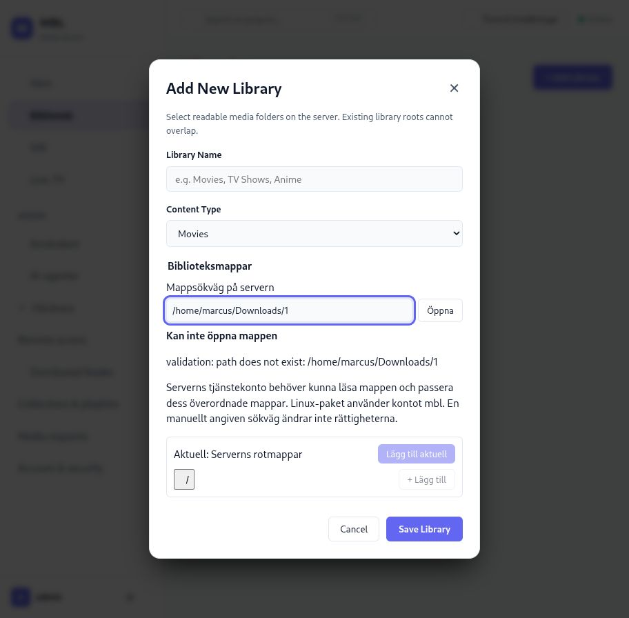
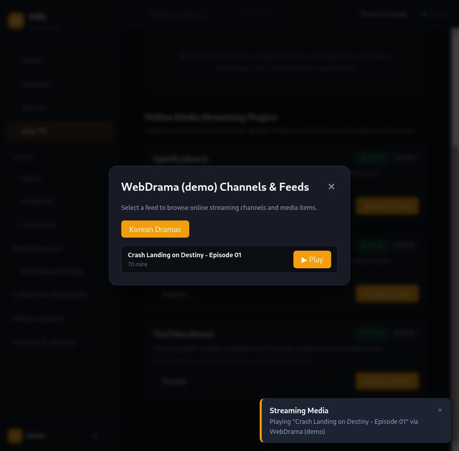

# MBL 1.1.0 — test av den installerade versionen

Datum: 2026-10-29. Installation: `mbl 1.1.0-1`, ARM64 Debian-paket på hallon,
`http://localhost:8420`. Testat med computer use som administratör, i normal
skrivbordsvy och vid 390 × 844 pixlar. Källkod och tjänstens filåtkomst har
kontrollerats där ett GUI-flöde stannade eller en funktion saknades.

Detta är en användbarhets- och funktionsgenomgång av den verkliga installationen.
En sida som laddar räknas inte som verifierad uppspelning eller färdig integration.
Under granskningen skapades inga nya tokens, konton, mediebibliotek, kanaler eller behörigheter.
Hårdvarans självtest kördes; övriga utförda formulärförsök hade tomma obligatoriska
fält och avvisades. Ingen produktionskod ändrades då och ingen ny release byggdes.

## Senare uppföljning — WebDrama batch 2–5

Den första riktiga sök-/källkontrollbatchen finns nu i arbetskopian och provas
på en helt separat server på `http://127.0.0.1:18421`. Den ger internetsökning,
privat metadataindex per användare, strukturerade säsongs-/avsnittslänkar och
avkodade prov för direktmedia. Batch 3–5 lägger till valbar sökleverantör,
rättad avsnittskoppling och en inloggningsbunden VOD-HLS-spelare med personlig
historik/återupptagning. Verklig HLS-uppspelning, spolning och återupptagning från
1:41 är verifierade i browsern. LIVE-01 är **delvis implementerat**: bredare
streamingträffar, sidextraktorer, riktiga dramaserier och koppling till bibliotekets
Continue Watching/Up Next återstår. Installationen på 8420 är oförändrad.
Se [batch 2-rapporten](2026-10-30-webdrama.md) för verifiering, skärmbilder och
gränser samt [batch 5-rapporten](2026-10-30-hls-player.md) för HLS-testet och
återstående begränsningar. Batch 1-tabellen nedan behålls som historik.

## Implementationsstatus — första batchen efter granskningen

Ändringarna nedan finns i arbetskopian och är provade i testklienten på
`http://localhost:18420`, som använder den installerade serverns API på 8420.
Installerade 1.1.0-binärer, releasetaggen, hemkatalogens rättigheter och Test-
bibliotekets rot är oförändrade. Fynden längre ned beskriver det ursprungliga
liveprovet och behålls som historik.

| Fynd | Status efter batch 1 |
| --- | --- |
| LIVE-01 WebDrama/plugin-Play | Falsk Playing-framgång borttagen. Demo och utebliven streaming förklaras; uppspelning är spärrad. Laddning/fel/Retry/avbrott/sena feedsvar hanteras. **Verklig internetsökning, indexering och uppspelning återstår.** |
| LIVE-02 Mappval | Klientfelet rättat: synligt REST-fel, hjälp om tjänstens rättigheter, manuell validerad sökväg, timeout/avbrott, skydd för sena svar och snabb inmatning. Riktig filåtkomst och befintlig rot behöver fortfarande korrigeras före spelaracceptans. |
| LIVE-08 API-upptäckbarhet | Rättat i klienten: synlig länk i inställningar och sökbart kommando; API-sidan öppnas i samma flik och har verifierats i webbläsaren. |
| LIVE-09 Mobilens nodnavigering | Rättat i klienten: nodlänk i mobilens inställningar och nodkommando i paletten. Även agent-/hårdvarulänkar finns i inställningarna; administratörskravet behålls. |
| LIVE-11 Biblioteksdialog | Gemensam semantisk dialog med initialt fokus, Escape, fokusåterställning och begränsad höjd/rullning. Provad i tester och webbläsare. |
| Övriga fynd | Kvarstår. Nya mapp-/demotexter finns på alla fem språk; detta löser inte hela LIVE-10. |

Verifiering: webbsvit 166 tester, TypeScript/Vite och bundle-budget passerar;
initial JS 45,03 KB gzip. Biome har 0 fel och tidigare 5 varningar/4 infos.
Riktade tester täcker mappfel, manuell/kanonisk sökväg, inmatning under första
listningen, sena svar, timeout/avmontering, dialogfokus/Escape, REST-konflikt,
demo-status och pluginers fel/Retry/sena svar/avbrott. Computer use bekräftar
synligt fel mot den verkliga privata mappen, läsbar `/tmp/../tmp` → `/tmp`,
temporärt mappval utan sparat bibliotek, demo-status, nodnavigering vid 390 px
och öppnad API-referens. Ingen Rust-/API-kod eller databas ändrades.

## Viktigast inför nästa arbete

Användaren prioriterar **WebDrama högst**. Önskemålet är en generell titelsökning
över internet, till exempel ”Single’s Inferno”, som hittar streamingkällor.
Det är inte begränsat till koreanskt drama eller ett par förvalda webbplatser.
Riktiga serier, säsonger och avsnitt ska indexeras och presenteras lättillgängligt.
Snabb kontroll av den verkliga videokällan ska ge ärlig uppspelningsstatus.
ML önskas för analys/matchning; ett modellresultat ersätter inte ett faktiskt
uppspelningsprov. Dagens demo är långt från detta acceptanskriterium.

## Verifierade flöden

| Område | Utfört test och resultat | Gräns för verifieringen |
| --- | --- | --- |
| Inloggning | Tomma uppgifter ger validering; korrekt inloggning öppnar appen. | Ingen ändring av lösenord eller 2FA. |
| Navigation | Samtliga sidomenylänkar öppnades: Home, Libraries, Search, Live TV, Users, AI Agents, Hardware, Remote access, Distributed Nodes, Collections, Requests, Account och Profiles. | Laddning av vyer, inte alla bakomliggande mutationer. |
| Bibliotek | Befintligt Test öppnas; 0 objekt visas. Lägg till-dialog, typval TV Shows och navigering `/` → `/home` fungerar. | `/home/marcus` stoppar fortsatt val; se LIVE-02. |
| Sökning | Sökning efter `test` ger tydligt tomt resultat. | Inget indexerat innehåll att verifiera relevans eller positiva träffar mot. |
| Live TV | Alla fyra flikar, EPG-fönster och tomma listor laddar. Tunerupptäckt initierades; inga tuners visas registrerade. | Ingen verklig tuner/källa, guide eller inspelning konfigurerad. |
| Import och DVR-formulär | Tom M3U, tom XMLTV och serieregel utan titel avvisas med specifika meddelanden. Retentionsval och serie-/säsongsfilter visas. | Inga riktiga källor importerades eller inspelningar startades. |
| Hårdvara | Nytt självtest kördes och avslutades med **10/10 PASS**, med uppdaterade FPS-resultat i tabellen. | Detta verifierar självtestflödet, inte Hailo-inferens, fysisk Cast eller verklig videouppspelning. |
| Användare | Användarlista och befintlig behörighetsdialog laddar med bibliotek, rating och PIN-status. | Ingen användare, inbjudan eller säkerhetsinställning ändrades. |
| AI-agenter | Tokenlista, auditvy och anslutningsguidens behörighet/nätverk/giltighetstid visas. | Ingen token skapades; verklig extern MCP-klient anslöts inte. Se LIVE-03/04. |
| Fjärråtkomst | Status laddar. Run diagnostics ger ett resultat med `isDirectReachable: false` och uttryckligen ofullständig räckbarhetskontroll. | Tailscale är Unavailable. WAN-åtkomst är inte verifierad. |
| Workers/noder | Båda listorna laddar och visar 0 registrerade. | Ingen worker eller lagringsnod kopplades. |
| Samlingar/spellistor | Växling mellan Collections och Playlists fungerar. Tomt namn stoppas av formulärvalideringen. | Inga poster skapades eller medier lades till. |
| Medieförfrågningar | Formulär/lista laddar; tom titel avvisas. | Inga förfrågningar skickades. GUI:t anger att automatisk Radarr/Sonarr-leverans inte är ansluten. |
| Konto/profil | Aktuella sessioner och 2FA-status visas. Plex/Jellyfin-val byter exempel. Nuvarande profil återgår till Home. | Ingen historik importerades, session återkallades eller 2FA ändrades. |
| Inställningar | Dialogen visar teman, accentfärger, språk och reducerad rörelse. Escape stänger den. | Preferenser ändrades inte som del av testet. |
| Kommandopalett | Ctrl+K öppnar; `hardware` filtrerar och Enter navigerar till Hardware. | Noder saknas som navigeringsval, se LIVE-09. |
| API-referens | `/api/docs` laddar v1.1.0 och ett verkligt GET till OAuth-metadata ger **200 OK**. | Ett lyckat HTTP-anrop innebär inte att OAuth-innehållet är korrekt; se LIVE-03. |
| Mobil | Startsida, bibliotek, biblioteksdialog, Live TV och bottennavigation provades vid 390 px. Kontrollerade sidor har ingen horisontell sidöverströmning. | Telefonhårdvara och alla innehållsberoende vyer provades inte. |

Webbläsarens insamlade varnings-/fellogg för huvudfliken var tom. De observerade
produktproblemen är ändå reproducerbara: klienten kan ignorera ett API-fel och
en Play-knapp kan enbart visa en notis utan ett konsolfel.

## Fynd och föreslagen prioritering

### LIVE-01 — P1: WebDrama och plugin-Play saknar verklig uppspelning

**Liveprov:** Live TV → Virtual & Plugins → WebDrama → Browse Feeds.
Endast Korean Dramas och `Crash Landing on Destiny - Episode 01` finns.
Val av kategorin ger inte fler serier. Play visar ”Playing …” men öppnar ingen
spelare; dokumentet innehåller 0 `video`/`audio`-element efter klicket.
Spotify provades också med samma uteblivna uppspelning.

**Kod:** `crates/mbl-service/src/plugins.rs` innehåller den hårdkodade katalogen,
med `stream_url: None`. `web/src/pages/LiveTv.tsx` låter pluginernas Play-knapp
enbart anropa `showToast`. Samtliga tre leverantörer märks som demo i listvyn.

**Nästa steg:** först ärlig status och spärrad uppspelning utan spelbar källa;
därefter det riktiga sök-/index-/säsongs-/avsnitts-/spelflödet som användaren
prioriterar. En demokatalog och en ”Playing”-notis räcker inte som acceptans.

### LIVE-02 — P1: mappval stannar utan förklaring vid åtkomstfel

**Liveprov:** Libraries → Add Library → `/` → `home` → `marcus`.
Vyn stannar på `/home` utan ett synligt fel, även vid nytt försök med den
semantiska knappen. Ingen möjlighet att skriva en exakt sökväg visas.

**Orsak bekräftad:** tjänsten kör som `User=mbl`, `Group=mbl`, med
`ProtectHome=read-only`. `/home/marcus` är `drwx------ marcus marcus`.
Det stoppar tjänstens traversal till den angivna mappen
`/home/marcus/Downloads/1`. Read-only-mounten ger inte Unix-läsrättigheter.

**Klientfel:** `browseFolder` i `web/src/pages/Libraries.tsx` läser bara `data`
från GET-resultatet. Ett HTTP-fel i `error` kastas inte och ignoreras därför.
Backend validerar läsbarhet i `crates/mbl-service/src/paths.rs`.

**Nästa steg:** visa konkret åtkomstfel och vilken tjänsteanvändare som behöver
läsa mappen; erbjud manuell sökväg med servervalidering och relevant hjälp.
Rättigheter ska lösas avgränsat för vald media. Inga filrättigheter ändrades.

### LIVE-03 — P1: OAuth-discovery innehåller ogiltig issuer

API-referensens riktiga GET ger 200 men kroppen anger `issuer: "/"` samt
relativa OAuth-endpoints. Koden i `crates/mbl-api/src/routes/oauth.rs` hårdkodar
dessa värden. Protected-resource-metadatan använder också relativa värden.
Det är ett interoperabilitetsfel: OAuth-metadata kräver en absolut issuer och
validering mot den adress från vilken metadata hämtades.
Se [RFC 8414, §2 och §3.3](https://www.rfc-editor.org/rfc/rfc8414.html#section-2).

**Nästa steg:** korrekt kanonisk serveradress och fungerande extern klient som
acceptans. Bearer-token-flödet ska verifieras separat; det testades inte här.

### LIVE-04 — P1: agentguidens stdio-brygga följer inte med installationen

Guiden visar behörighetsval och Generate Token. Källan genererar därefter
konfiguration för VS Code, Claude Desktop, Cursor och Generic stdio.
Claude-/stdio-exemplen i `crates/mbl-service/src/mcp.rs` använder `mbl-cli mcp`.

`dpkg-query -L mbl` visar endast `mbl-server`, `mbl-worker` och `mbl-node` i
`/usr/bin`; `mbl-cli` finns inte på PATH. Releasejobben bygger inte heller
CLI-paketet. Handboken hänvisar dessutom till en annan körbar fil, `mbl-mcp`.

**Nästa steg:** leverera en fungerande brygga eller generera konfiguration för
den faktiskt installerade HTTP-transporten. Förklara serveradress från andra
datorer och visa ett test av anslutningen. En ny token skapades inte i granskningen.

### LIVE-05 — P1: Home Assistant är en ofärdig integration

Ingen Home Assistant-/MQTT-konfiguration hittades i GUI:t. MQTT-modulen i
`crates/mbl-remote/src/mqtt.rs` bygger discovery-payloads och tolkar kommandon,
men servern kopplar inte in en MQTT-anslutning eller publiceringslivscykel.
Detta är även dokumenterat som öppet i restlistans punkt 11.

**Nästa steg:** faktisk brokeranslutning, konfiguration, anslutningstest,
discovery, status/kommandon och tydlig GUI-guide. Det går inte att ansluta
integrationen från nuvarande 1.1.0-GUI.

### LIVE-06 — P2: Windows-MSI saknar installationsguide

**Användarrapport och kodkontroll, inte ett Windows-liveprov.**
`packaging/windows/mbl.wxs` anger `ProgramFiles64Folder/MBL` och definierar
server/worker/node/TV-features men saknar en WiX UI-guide. Byggskriptet länkar
inte `WixUIExtension`. Därför saknas GUI för installationsmapp och komponentval.

**Nästa steg:** installationsguide med binärmapp, relevanta komponentval och
tydlig skillnad mellan program och data; uppgradering och avinstallation måste
provas på Windows. Påstå inte att den plattformskontrollen redan är gjord.

### LIVE-07 — P2: virtuell kanal kan inte få innehåll genom guiden

Create Virtual Channel har bara namn, kanalnummer och ordningsläge.
Ingen medieväljare finns. `handleCreateVirtualChannel` i LiveTv.tsx skickar
alltid `itemIds: []`. Den utlovade kanalen av bibliotekets innehåll kan därför
inte byggas i detta GUI-flöde. Tomt namn avvisas korrekt; ingen kanal skapades.

**Nästa steg:** välj/ordna innehåll, förhandsgranska schema och verifiera spelbar
kanal. Se också restlistans bredare arbete med virtuella kanaler.

### LIVE-08 — P2: API-dokumentationen är svår att hitta

Referensen på `http://localhost:8420/api/docs` fungerar. Specifikationen finns
på `/api/openapi.json`. Ingen länk till dessa hittades i appens genomgångna
menyer, inställningsdialog eller kommandopalett.

**Nästa steg:** en synlig Hjälp/API/Integrationer-ingång med serveradress,
autentisering och konkreta exempel.

### LIVE-09 — P2: distribuerade noder saknar navigering på mobil

Skrivbordets sidomeny har Distributed Nodes. Vid 390 px ersätts menyn med
bottennavigation. Inställningarna saknar nodlänk och kommandopaletten saknar
nodkommandot; sökning efter `node` ger inga träffar. Direkt-URL:n är känd,
men administratören saknar en normal synlig väg dit i den provade mobilvyn.

**Nästa steg:** fullständig administratörsmeny och motsvarande palettkommandon.

### LIVE-10 — P2: svenska valet lämnar stora delar på engelska

Mobilflikens inställning är Svenska och navigationen visar Hem, Bibliotek,
Sök och Live-TV. Samtidigt är startsidans tomvy, Libraries-formuläret,
Live TV-flikar och stora delar av kommandopaletten på engelska.
Det är direkt observerat; inga språkpreferenser ändrades under testet.

**Nästa steg:** använd översättningar i hela användarflöden och prova dem som
användare, inte enbart nyckelparitet i språkfilerna.

### LIVE-11 — P2: biblioteksdialogens tangentbord/tillgänglighet

Escape stänger inte Add Library. Fokus stannar på den bakomliggande Add
Library-knappen vid öppning, och bakgrundens länkar exponeras i tillgänglighetsträdet.
Modalen är handbyggda div-element utan gemensam Dialog-komponent i Libraries.tsx.
Den gemensamma Settings-dialogen klarar Escape.

**Nästa steg:** semantisk dialog, initialt fokus, fokusfälla, stängning med
Escape och återställt fokus. Dialogen ryms visuellt på provad mobilbredd.

### LIVE-12 — P3: tom startsida ger fel nästa steg

Home säger ”Create your first media library” trots att Test redan finns.
Rätt nästa steg är att granska sökväg/åtkomst och skanna ett befintligt bibliotek,
inte att skapa första biblioteket igen.

## Befintlig konfiguration som blockerar spelarprovet

Biblioteket **Test** har typen Show, rot `/` och 0 katalogobjekt. Tjänstens logg
visar en avslutad skanning med 665 undersökta filer, 0 tillagda och 665 misslyckade
prober, inklusive TypeScript-typfiler vars ändelser liknar transportströmmar.
Ingen rotskanning startades som del av testet.

Den valda mediamappen innehåller en serieepisod, men tjänsten kommer inte igenom
den privata hemkatalogen. Dessutom förhindrar backend avsiktligt överlappande
biblioteksrötter: med Test på `/` skulle ett nytt bibliotek för en undermapp
kollidera även efter att åtkomstfelet lösts. Befintligt Test behöver få en korrekt,
avgränsad rot eller hanteras på annat uttryckligt sätt. Inga bibliotek ändrades
eller raderades under testet.

Uppspelning, seek, ljud-/textval, nästa avsnitt, återupptagning, Cast och historik
kan därför **inte** godkännas efter detta prov. Detsamma gäller verklig Live
TV/DVR utan källa, workers utan anslutna noder och Home Assistant utan runtime.
Grundorsaken för spelarblockeringen är känd och nästa prov kan göras efter en
avgränsad korrigering av bibliotekets rot/filåtkomst.

## Acceptans för det prioriterade WebDrama-flödet

1. Användaren skriver en titel, till exempel ”Single’s Inferno”; tjänsten söker
   på internet efter relevanta streamingkällor, även utanför koreanskt drama.
2. Resultat visar rätt serie och ursprungskälla; dubbletter och falska träffar
   hanteras. Indexet bygger riktiga relationer serie → säsong → avsnitt.
3. Sökning, affischer, beskrivningar och avsnittsval är lätta att använda på
   svenska i både mobil- och skrivbordsvy.
4. Snabb verifiering kontrollerar aktuell källa och verklig media. Spelbar,
   kräver inloggning/extern spelare, otillgänglig och okänd status skiljs åt.
   ML kan bidra till matchning; faktisk format-/uppspelningskontroll behövs.
5. Play öppnar en riktig spelare för verifierad källa, med fungerande seek,
   ljud/text där källan erbjuder det, återupptagning och nästa avsnitt.
6. Källfel förklaras och kan provas om; ingen ”Playing”-notis ges som ersättning
   för faktisk uppspelning. Gamla indexuppgifter får inte garantera spelbarhet.
7. Acceptans körs med verkliga avsnitt och inkluderar flera säsonger/serier,
   försvunnen källa, fel titel, inloggningskrav och nekad uppspelning.

## Nästa arbetsordning

- WebDrama: ärliga kontroller/status och en konkret implementation av det nya
  internetbaserade sök-/index-/spelflödet.
- Bibliotekets åtkomst, felmeddelanden och avgränsade rot, så att kärnspelaren
  kan verifieras på den installerade versionen.
- Agenternas metadata/brygga, Home Assistant, API-upptäckbarhet och Windows-guide.
- Virtuella kanaler, mobilnavigering, översättningar och dialogbeteende.
- Riktiga acceptansprov för varje flöde innan det räknas som färdigt.

Övriga kvarstående produktområden finns i [den befintliga restlistan](remaining-work.md).
Den här rapporten ersätter inte dess öppna punkter med godkännanden.

### LIVE-13 — P2: sparade språk-/temapreferenser läses inte vid ny inloggning

**Uppföljning 2026-10-30 på separat testserver.** Testkontot hade sparat Svenska
men gränssnittet stannade på engelska efter inloggning. Omladdning läste in
Svenska och det sparade temat. `ThemeContext.tsx` synkar enbart i `onMount`;
`syncWithBackend` anropas inte när inloggningens användare ändras.

**Nästa steg:** bind preferensladdning till aktuell användare och skydda mot sena
svar från tidigare inloggningar/profiler. Detta rättades inte i WebDrama-batchen.
