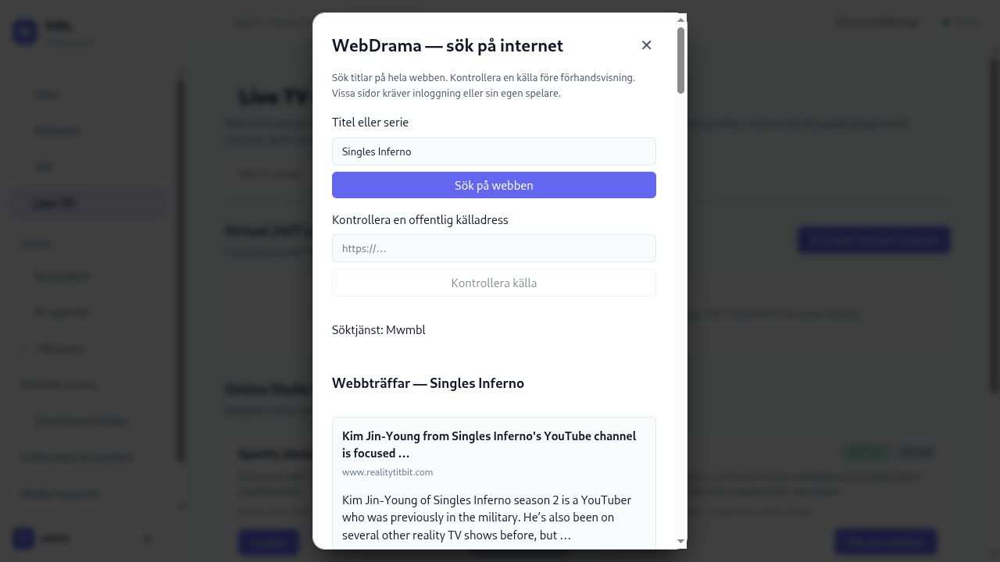
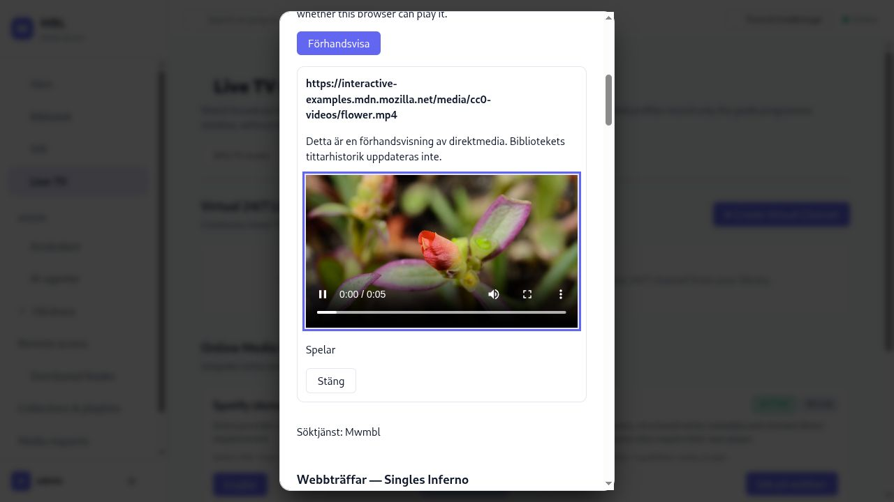

# WebDrama — live audit implementation batch 2

Date: 2026-10-30. Local source changes after v1.1.0; no commit, tag, package or
installed-service update. The isolated preview uses `http://127.0.0.1:18421`
with its own data/cache and disposable account under `/tmp/mbl-online-dev`.
The installed service at localhost:8420 and its accounts/libraries are unchanged.

## Implemented

- Real title search through the Mwmbl web API, replacing WebDrama's fixed demo
  feed. Search runs on submit, is rate limited and cached, and does not imply
  that any result is a streaming page or playable video.
- Manual public-source inspection. Bounded JSON-LD parsing extracts a series,
  season, episode and up to 64 episode links where the page publishes them.
  Each episode can be checked independently. There is no automatic episode crawl.
- Migration `0012_online_sources.sql` stores derived inspection metadata per
  user. Signed URLs are not shared between users. The cache has a 64 KiB document
  limit and a server-wide 512-document bound; user deletion cascades the rows.
- Real FFprobe stream detection followed by FFmpeg decoding of a primary-stream
  sample. The server uses its configured/resolved media tools. A check fetches
  at most 4 MiB per source/media request, allows two concurrent inspections,
  and has a total 18-second deadline. Decoders read local snapshots with protocol
  and format allowlists, bounded output and process timeouts.
- A direct-media browser preview with reinspection before opening, real Playing
  events, load timeout/error feedback and cleanup when closed. A metadata-ready
  player remains available while the user decides when to press Play.
- REST search/inspection and matching read-scope MCP tools. Restricted profiles
  are rejected, as are private/reserved destinations, embedded credentials,
  custom ports and private redirects. DNS answers are validated and pinned on
  every HTTP hop. Untrusted website text stays data and is escaped in the UI.

## Live observations and limits

Computer use against the isolated server confirms that `Singles Inferno`
returns 20 real web results from Mwmbl. The returned pages are mainly articles,
recaps and news, shown as **Inte kontrollerad**. This verifies real discovery,
not successful streaming of that series. Search relevance/coverage is still
below the user's acceptance requirement.

The UI also shows an explicit error for `http://127.0.0.1/private`. No request
to that private source is made by the inspector.

The public MDN flower MP4 exposed a real verifier defect: mapping both audio
and video with a one-frame limit per output could finish on the audio frame
before emitting any video. FFmpeg exited successfully with `frame=0`, so MBL
correctly refused approval, but a valid video was rejected. The verifier now
maps only the primary video stream (or audio for an audio-only source). The
synthetic regression clip includes both H.264 and AAC to cover this case.

After the fix, the same public video passed inspection and reinspection in the
GUI. Keyboard Play started actual browser playback and the UI showed **Spelar**.
The video reached `currentTime=5.055`, `duration=5.055`, `ended=true`,
`readyState=4`, with no media error. Closing the preview removed the video
from the document. Screenshot and read-only media evidence are saved below.

One inspection timed out while the full workspace build was under heavy memory
pressure (FFprobe alone took 3.86 seconds against a four-second deadline). Retry
succeeded. Timeout remains an honest unconfirmed result, not approval; source
check latency under concurrent heavy workloads needs further acceptance testing.

At 390 × 844 px the dialog measures 358 px wide with 16 px margins; document
scroll width is 390 px and no dialog child overflows horizontally. The temporary
viewport override was reset after the test.

Structured multi-season episode extraction and per-user index isolation are
verified with controlled regression fixtures, not with a complete real-world
drama catalogue. HLS playlists are explicitly reported as requiring an external
player; no segments are followed by the sample verifier. Generic JavaScript
extraction, site adapters, login/DRM, subtitles, ML title matching, automatic
source verification/ranking, normal watch history/resume/Up Next, transcoding
and Cast remain unfinished. The direct preview is not the normal library player.

## Verification

Full ARM64/Linux Rust regression: **425/425 pass, 0 skipped** with nextest,
no fail-fast, two test threads and the repository's reduced-debug/NO_PROXY flags.
This includes 11 online service tests (real H.264/AAC decoding, private/index
isolation, tool paths, invalid media, stale checks, disabled plugins and profile
restrictions), REST/MCP checks and all existing playback/DVR regressions.

Frontend: **175 tests pass**, TypeScript/Vite build, 47.65 KB initial gzip JS
budget and Biome (0 errors, existing 5 warnings/4 infos). Affected-crate Clippy
with all targets and `-D warnings`, OpenAPI, tokens, formatting and diff checks
pass. TypeScript bindings and MCP snapshots are regenerated: 32/37/77 scoped
tools, with 151/151 paths covered or excluded. No Windows, real tuner, Cast,
WAN or full-series streaming acceptance is claimed.

The user guide explains usage and limits in `docs/book/src/online-discovery.md`.
The isolated preview remains available; the old 18420 Vite preview is stopped.
The follow-up also found preferences not refreshing at sign-in; LIVE-13 in the
original audit records this separate issue for a later batch.

Read-only browser media state: [playback.json](assets/2026-10-30-webdrama/playback.json).
Mobile evidence: [mobile view](assets/2026-10-30-webdrama/mobile.jpg).
